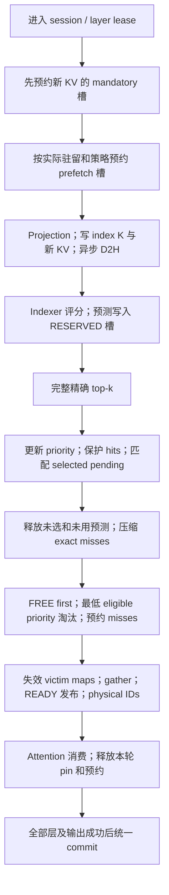

# Session 共享 pool 的 cache allocator 重构方案

状态：设计方案，尚未实现或测量。日期：2026-10-12。

建议保留现有 session 生命周期和逐层共享 pool，新增一个只负责槽位分配的
`SlotAllocator`。它维护空闲状态、可比较的优先级、所有者和预约；模型 adapter
负责 token 映射、KV 搬运和驻留发布。每层先预约新 KV，再给 prefetcher 分配本轮
额度；Indexer 后用 score 更新优先级，保护精确命中，释放未选预测，为完整 top-k
的剩余 miss 分配空间。

首轮实现保持多 session 串行执行，各 session 的历史同时保留在 pool 中。跨 session
并发执行需要独立的 consumer 和 IO 同步设计，不作为这轮重构的前置条件。

## 1. 现有结构与重构范围

当前已经有多 session 共享 storage，无需另造一套 session 管理。

| 当前代码 | 当前职责 | 重构后的职责 |
| --- | --- | --- |
| [CacheManager](../../../../cache/manager.py#L236) | 创建、释放请求 session | 保留外层入口 |
| [SharedSparseTokenPool](../../../../cache/sparse_token_pool.py#L98) | 共享 host arena、逐层 HBM pool、scratch | 持有 allocator、residency 和共享 workspace |
| [_LayerPool](../../../../cache/sparse_token_pool.py#L54) | records、双向映射、priority、free、clock | 拆出 slot 分配状态；records 和映射留给 residency |
| [SparseTokenSession](../../../../cache/sparse_token_pool.py#L909) | session owner、host pages、各层 view | 增加每层实际驻留统计与预算参数 |
| [SparseTokenCache](../../../../cache/sparse_token_cache.py#L33) | append、精确 recall、事务 | 组织预约、搬运、发布及消费 |
| [attention.forward](../../../../models/deepseek_v32/attention.py#L276) | projection、Indexer、append、recall、attention | 接入新的前后两阶段流程 |

每张 GPU 上，**每层各有 P 个可分配的历史槽**，另有 sentinel。多个 session 在
同一层争用这 P 个槽；不同层的 slot 17 对应不同 storage。预算使用
`resident_count[session, layer]`，不能把各层驻留数量相加，也不能用 history 长度 H
或 `P−H` 代替实际空槽数量。

通用边界按模型声明的 record 或 block 分配，大小、dtype 和布局由 adapter 提供。
下文以 DeepSeek token record 说明执行流程，不把它的 page64、MLA record 或 top-k
宽度写进通用 allocator。当前工作区不存在 `models/nosa/` 和 `operators/nosa/`，
因此首个具体接入对象为现有 DeepSeek；NOSA 的分配单位、score 聚合和消费约束需在
其模块与规则具备后补齐，不能视为已验证兼容。

## 2. 职责、状态和接口

| 组件 | 持有的状态 | 负责的操作 |
| --- | --- | --- |
| `SlotAllocator` | FREE 状态、分层空槽索引、priority key、owner/generation、reservation、pin | reserve/alloc、选 victim、release、更新 key |
| `ResidencyAdapter` | 逻辑/host↔physical 映射、每 session/layer 的 resident list 与计数、pending lookup | 失效旧映射、发布新映射、生成 attention IDs |
| `Transfer` | record storage、copy/gather ticket、ready event、写回源 | KV 搬运、完成依赖和 storage 保活 |
| `BudgetPolicy` / `PriorityPolicy` | session 目标/配额、预取参数、score 归一化和年龄参数 | 输出请求预算、可淘汰范围及可比较的 key |
| session/runtime | 准入 owner、执行 lease、有效长度、事务状态 | 跨层提交、失败清理、释放 |

Allocator 不计算 top-k，不读取 GR 请求，不搬 KV，也不管理 host page LRU。
`alloc` 成功只说明空间已经预约，不能据此认证 KV 已驻留。

仅有 free bit 和 priority 不够描述异步写入。每槽至少保存：

```text
state: FREE / RESERVED / READY
owner: session_id + generation
reservation: operation_epoch + purpose
priority_key
pin: append / host-not-ready / exact-consumer / in-flight
```

`purpose` 区分 append、speculative 和 exact miss。pin 是独立的禁止重用条件；
READY record 在 host 写回未完成或 attention 尚未消费完时仍不可淘汰。
sentinel 和 DeepSeek candidate tail 不进入这套历史槽状态。

通用契约和 Python facade 拟放在 `cache/slot_contracts.py`、`cache/slot_allocator.py`，
不导入模型实现；通用 GPU 槽位管理拟放在 `operators/common/slot_allocator.py` 和
对应 `csrc/`。DeepSeek 的 score/prefetch/reconcile 适配仍放在自身 indexer 目录，
不将 WGMMA 或 MLA record 布局带入通用算子。

接口草案如下，动态数量留在 GPU，输出 buffer 按规划上界固定分配：

```python
policy.request_prefetch(resident_view, session_policy, pool_summary) -> device_budget
policy.eviction_eligibility(purpose, session_policy) -> eligibility
priority_policy.make_keys(scores, resident_ids, policy_state) -> keys

allocator.reserve(lease, device_count, count_bound, purpose, eligibility) -> ticket
allocator.update_priority(lease, slot_ids, keys, valid_count)
allocator.release(lease, ticket, completion_dependency)

residency.invalidate_victims(ticket)
transfer.materialize(ticket, record_sources)
residency.publish_ready(ticket, completion_dependency)
```

ticket 包含合法槽表、有效数量、victim 身份和 operation epoch。Mandatory demand
必须获得完整数量，speculative demand 可以少授予或授予 0。先核验可分配数量，
再提交预约；容量不足不能留下半份 mandatory assignment。GPU 错误状态在现有
完成/事务边界向上传播，后续 kernel 不得继续覆盖 storage。

换 owner 时，先使旧映射失效并减少原 session 的 resident 数，再覆盖 record；
完整拷贝就绪后才能发布新双向映射和 READY，增加新 session 的 resident 数。
预约 ticket 保留旧 owner 的失效信息，不能在 adapter 消费前覆盖；状态与映射的
阶段转换在同一独占 lease 内完成，各阶段边界核验计数一致。
同 stream 以 kernel 顺序建立依赖；跨 stream 必须等待 event 或使用经验证的
release/acquire 协议。不能把一次 atomic claim 当作 record ready。

## 3. Session 预取预算

预算分三层记录：策略请求 `B_requested`、实际预约 `B_granted`、真正搬入的
`B_copied`。预测被精确选中并保留的数量另记 `B_promoted`，未选预测的流量也计费。

设备侧 `ResidentView` 至少包含当前层的：

- 已初始化历史中实际 READY 的数量 `R_history`；
- 本轮新 KV 的 READY/RESERVED 数量，以及 host-not-ready 的数量；
- 当前 session 的其他预约、pin 和 history 缺失数量；
- 全池空槽、其他 session 可淘汰数量及配额保护状态。

临时预测不计入 `R_history`，新 KV 也不能伪装成本轮开始前的历史驻留。
resident list/count 随失效和 READY 发布更新，禁止每层 `.item()` 取回再决定额度。
CPU 在准入或显式策略更新时设置目标，GPU 在每层执行时计算实际预算。

预算接口允许后续替换策略。首个可测的策略可采用目标缺口：

```text
gap = max(0, target_history_resident[s,l] − R_history[s,l])
B_requested = min(prefetch_limit[s,l], missing_history,
                  max(gap, cold_start_floor if R_history == 0 else 0))
B_granted <= min(B_requested, Bmax, legal_capacity_after_append)
```

这只是初始策略，不宣称它最优。也可接入随 miss 比例或驻留数量变化的策略。
`Bmax` 是预分配的物理/元数据上界，不是每次必须使用的固定预算；支持
`B=0/1/64/>64`。cold-start 规则避免 `R=0` 时一直得不到预取。

Session 的目标是软目标，硬上限和不可借用的保底另由接口声明。额度保护必须计入
READY 和 RESERVED 的实际所有权，不能只看已发布 record；软目标不能承诺每个
session 都同时达到目标。分配器仍遵守全局物理容量和当前 pin。

保底和硬上限采用设备侧额度扣减或按 owner 约束选择。每个 victim owner 本轮
可借出的最大数量，以及 requester 剩余可占用数量，必须共同约束 grant；不能让
多个 CTA 各自看到“尚有保底之外的空间”就同时超额淘汰。Mandatory demand 也
不能绕过 requester 硬上限，应在准入/消费组规划时确认可行。

建议首版采用以下分配策略，并保留 FREE-only 作为 reference：

| 需求 | 空槽不足时允许淘汰的集合 | 优先级来源 |
| --- | --- | --- |
| 新 KV mandatory | host backing 已就绪、未 pin、满足配额规则的记录 | Indexer 前的旧 key |
| speculative prefetch | 其他非执行 session 中已就绪、未 pin、允许借用的记录 | 旧 key；不为预测淘汰当前 session 的历史 |
| 精确 top-k miss | 所有合法未 pin 的记录，排除本组精确选择 | 当前 session 更新后的 key；其他 session 的存储 key |

各集合内部始终先用 FREE，再选最低 key。若所有槽都属于当前 session 且已满，
prefetch 可以授予 0，Indexer 后仍完整召回。这是策略选择，不是 allocator 只能
分配空槽。要在单 session 满池时持续预取，应由后续策略显式保留 headroom 或
允许预测淘汰，并重新测量额外 recall。

在已有 warm 例子中，若 `P=65,600`、GPU 确认 `65,536` 条历史全驻留，先预约
一个新 KV 后，空槽最多为 **63**。预算可以是 0–63；不能沿用“必须准备 64”的
条件。若历史尚有 miss，实际空槽由 GPU 状态决定，会与 `P−H−1` 不同。

## 4. 一层 decode 的新流程



### Indexer 前：预留新 KV 与预测空间

进入现有独占 layer lease 后，先为普通持久 append 预约本层 `A` 个目的槽。
[reserve_append_source](../../../../cache/sparse_token_cache.py#L182) 当前只给异步
D2H 源腾出预算，没有预约物理目的槽；这两个预留都保留，但明确区分。

若 FREE 不足，按旧 priority 淘汰合法记录。此时还不知道本轮 top-k；被淘汰
记录若稍后被选中，就成为真实 miss。须分别统计 `pre_indexer_evictions` 和
`selected_after_early_eviction`，评估提前预约的额外搬运成本。不能在 Indexer 前
pin 整个历史，否则满池时无法预约新 KV。

然后计算本 session/layer 的预算并预约 speculative 槽。**预测 record 直接写入
这批 pool 槽，作为临时 pending**，不另分配一份同样大小的 record staging。
未 claim 的槽仍属于本轮预约，不能让其他分配器重用。

Projection 产生 KV 后写入已预约目的槽，无需再次 alloc。普通持久 KV 可以提前
启动异步 D2H；新 KV 在 host backing ready 前保持不可淘汰。保留现有
[write_host](../../../../cache/sparse_token_pool.py#L468) 对独立 projection source
和 event 的所有权，不能让后续 graph replay 覆盖源。是否能与 Indexer 重叠由
profile 验证。

### 预测只产生 pending，不发布普通映射

Prefetcher 只读取本 session 的已初始化历史，host backing 必须完成；当前 token
和 GPU-only candidate 不参与预测。预测阈值/算法由模型 indexer adapter 声明，
allocator 只提供 legal slots 和 GPU budget pointer。

首版在 reserve 阶段完成 victim 失效。为预测借出的其他 session 记录，即使随后
没有 copy 或预测全部未选，也已经失去原驻留；释放预约不恢复旧 maps/record。
分别记录 `speculative_reservation_evictions`、未用 grant 和被影响 session 的
后续 miss。以后可研究实际 claim 时才失效 victim，但需要新的 ticket 协议。

另建当前 lease 专用的 `(session, generation, host ID) → pending slot` lookup，
用于去重和 top-k 匹配。普通 `host_to_device` 在 promotion 前保持 MISSING；
pending 表含 claim/ready/epoch，完整 record 写入后才标记 ready。选中的预测在
原槽发布为 READY，省掉 record staging→pool 的第二次拷贝。

pending lookup 使用预分配、有界的哈希或索引结构，按 `Bmax` 规划容量及冲突处理；
不能用 `B×B` 或 `B×topk` 的两两扫描。容量设计必须保证在合法最大 claim 数下
可插入，错误直接传播，不能以丢预测隐藏 lookup 失败。用 epoch 和 touched IDs
清理本轮元数据，避免全 NH/P reset。

### Indexer 后：精确选择决定必须保留的内容

评分和精确 top-k 都完成后，Q1 直接处理该 query；Q>1 先按容量规划消费组，
再对每组执行以下流程，不能先 pin 全步精确并集：

1. 每层本轮更新一次 score policy，沿当前 session 的 resident-slot list 写入
   eviction key。更新量为 `R_history`，避免为了当前 session 扫全 NH；全合法
   history 的 score 归一化归约另计，不因消费分组重新计算。
2. 去重本消费组的精确选择用于分配，保护其 READY hits；原始 top-k 输出和重复
   语义不变。
3. 查 pending lookup，将本组选中的 ready 预测纳入精确工作集并 pin。仅被后续组
   选中的预测可在额度内保持未 pin 的 READY，也可释放后再 recall，不能占用本组
   无法释放的容量；实际行为和跨组重读分别记录。
4. 等预测 producer 完成后，释放未被本轮任何 query 选中的 record 和没有使用的
   预约；消费组之外的预测按前述可淘汰规则处理。
5. 压缩剩余精确 miss，获得 GPU count；为全部 miss 预约目的槽。
6. 失效 victim 映射，gather 剩余 miss，完成后发布 maps、resident counts 与
   attention physical IDs。选中预测在原槽发布，不再从 DRAM 读取。

**所有 hit pin 和 priority 更新必须全局完成后才能选 victim。** 不能让一个 CTA
正在保护 top-k，另一个 CTA 已按旧 pin 状态淘汰。Attention 完成后解除 consumer
pin；host-not-ready pin 由写回完成解除。当前 KV 不因被本组选中而重复分配。

### 容量与事务

对消费组 `g`，可行条件是其完整精确工作集中的历史 pool 部分，加上组外仍不可
释放的 append、consumer 和 IO pin，占用不超过 P；集合交集只计一次。跨 query 的精确并集过大
时保留现有 query 分组消费，每个 query 的完整选择不裁剪。已写回且不属于当前
消费组的新 KV 可以按契约解除 append pin，后续组需要时再 recall；尚未写回的
仍计入不可释放容量。若单 query 的工作集仍无法放入，需显式支持分块 attention
或报告不支持，不能偷偷缩短 top-k。分组属于正常容量调度，不是分配失败后重试。

DeepSeek transient candidate 沿用 [begin_transient](../../../../cache/sparse_token_cache.py#L244)
预约的独立 `P+1+i` 尾部，本层历史 pool 的 append 需求为 0。候选不写 host，
不进入历史 maps、pending host lookup、free 或 priority；成功后 discard。
选中的候选不计入 P 的历史工作集，其 `Amax` 尾部 storage 单独计入物理容量。

所有层及输出成功、必要 CUDA 完成确认后统一推进有效长度。执行失败直接报错；
清理先等待 producer/consumer，再释放本轮预约与 storage。无法确认异步完成时
保留 owner/storage 并禁用复用，执行异常和清理异常全部保留。回滚有效长度不等于
恢复原 HBM 命中集合，不能靠重新加载或重试请求掩盖失败。

## 5. Score priority 的定义

Allocator 只比较 `priority_key`。不同 session 的原始 score 不直接混用；由
`PriorityPolicy` 定义归一化、年龄与 session 权重。精确命中靠 pin 保护，不靠
把 priority 写成一个很大的值。

初始 score policy 可用如下明确、可核验的规则：adapter 为每个历史 record
聚合本轮 score，Q1 直接取该 score，Q>1 取各 query 有效有限 score 的最大值；
对本轮完整 score 矩阵可见的全部合法已初始化 history record 聚合，取其中有限
值的正部均值 `mu`，与实际驻留集合和消费分组无关。令
`z=clamp(max(score,0)/(mu+eps),0,zmax)`，写入
`key=w_session*z+lambda*last_update_epoch`。共同线性年龄项
`−lambda*current_epoch` 对所有槽相同，可在比较时省略。

`eps`、`zmax`、`lambda`、聚合方式和 session 权重均属于策略身份。某 record
无有限值时取 `z=0`，非有限值不进入归约；精确选择本身继续遵守原 nonfinite 与
并列规则。新 promotion、miss 和 append 在对应 score 可用后赋 key。
这项归一化只定义比较规则，不证明不同 session 的 token 价值相等；与 FIFO 一起
测量命中、淘汰公平性和总搬运量，再决定默认参数。

上述公式描述策略，M1 必须冻结实际 key 的 dtype、排序编码、舍入、范围和
priority epoch 更新规则。不能直接使用无限增长的 FP32 epoch 项，否则会吞掉
score 差异。可选择声明分辨率的整数最终 key，或有界高精度 key；量化若采用，
量化结果本身就是策略，不能声称仍按未经量化的 float score 严格排序。priority
epoch 的静止点 rebase、溢出检查和摘要同步更新，独立于 reservation epoch 清理。

闲置 session 保留上次 key，随全局层 epoch 相对老化；预算策略可保护保底份额。
改变权重或使用其他衰减函数时，必须重建或正确更新最小值摘要，避免摘要指向
失效 key。相同 eviction key 的槽可以任选，**这不放宽精确 top-k 的并列顺序**。

现有 [DeepSeek 规则](../../../../models/deepseek_v32/AGENTS.md) 定义的是 FIFO。
实施 score policy 时需新增策略版本和验收契约，保留 FIFO reference；不能宣称
新旧 priority、命中轨迹或流量相同。

## 6. GPU kernel 方案

先减少重复工作，再优化并行度。首版使用少量同 stream 顺序 kernel，保留必要的
全局阶段边界；一个 native API 或 CUDA Graph 只减少 CPU 调用，不等于所有节点
已经融合。

| 阶段 | 尽量融合的工作 | 并行方案与不可越过的依赖 |
| --- | --- | --- |
| Begin | 预算计算、预约计划、本轮计数/小 scratch reset | 小摘要可用少量 CTA；大批 alloc 走多 CTA，append 先于 speculative |
| Reconcile | resident priority 更新、exact 去重/分类/pin、pending 匹配、miss compaction | 按 resident list 和选择表分发多 CTA；全部完成后才能 eviction |
| Allocate | FREE first、缺口的最低 key 选择、assignment/victim ticket | 分层空槽摘要；按 demand 选择小 K 或多 CTA 大 K 算法 |
| Materialize | victim map 失效、copy/gather、READY 发布及 physical IDs | 失效先于覆盖；跨 CTA 拷贝完成后再全局发布/映射 |
| Release | 解除消费 pin、归还预约、统计 | 等 consumer/IO 完成，按 touched slots 更新 |

### 空槽分配：维护状态，不每次重建

持久维护 FREE bitmap、tile free count 和 nonempty hierarchy。claim/release
增量更新；先扫描小型 tile 摘要，再由多个 CTA 展开选中的 tile，按 bit rank 写出
足够槽位。极小 demand 只处理必要摘要，较大 compaction 才占用更多 SM。

这替代当前 L2/L11 的全池 mask 生成与单 CTA 扫描，也避免 append 再次计算同一
批空槽。每轮只重置 touched journal、assignment 有效范围和计数；operation epoch
回绕时，在无在途 owner 的静止点执行完整重置。

### 低优先级淘汰：多 SM 选出真正的最低 K

小 K 使用分层 min/tournament 摘要；key 或 eligibility 变化后增量维护对应 tile。
较大 K 使用多 CTA radix histogram/reduction 找到第 K 个 key 阈值，再并行压缩
严格低于阈值的槽和足够数量的等阈值槽。优先从无 pin 的合法集合选择，不能先选
全池最小值再跳过一部分，导致数量不足或排序错误。

粗桶只能作为严格选择的索引；除非策略明确把量化桶定义为最终 key，否则不能在
同桶中随便拿更高 priority 的记录。全局 barrier、摘要维护、原子竞争和小需求
launch 开销都需计入，不能假设增加 SM 一定更快。

eligibility 随 purpose、当前 session、pin 和配额变化，单份全池 `tile_min` 不足以
直接回答全部请求。先以多 CTA 的本轮 masked selection 建立正确性和计时基线；
摘要优化要提供匹配集合的索引，或重新过滤/计算候选 tile。不能跳过一个不合法
的 tile 最小值后，连同该 tile 的其他合法低 key 一起漏掉。

最低 K 指满足每个 victim owner 可借出上限后的合法最低 key 集合。先按 owner
保留其最多可借出的最低 key 候选，再做全局选择，或采用等价的有约束选择；
不能先做全局 K，再由 CTA 抢 owner credit 任意拒绝，否则可能淘汰更高 key。

### Reconcile 与发布：避免重现小 kernel 链

用 resident list、selected IDs 和 pending lookup 处理实际有效范围，避免当前
L8 即使没有预测也执行固定 `64×64` 检查。score 归一化若需要跨 CTA 归约，可与
候选遍历产生局部统计，但必须有全局结果之后才能形成最终可比较 key。

普通 `__syncthreads()` 不能提供 grid barrier。首版保留 reconcile→allocate→
invalidate→copy→publish 的必要 stream 顺序；对 CTA 独占槽可融合局部 copy 与
ready 写入，attention map 仍等待全体 producer。后续只有在 occupancy 准入、
cooperative grid sync 和 IO ready 协议都明确时，才考虑 persistent kernel。

## 7. 动态 ECHO 预算的落地路线

固定 64 贯穿 [official_prefetch.py](../../../../operators/deepseek_v32/indexer/official_prefetch.py#L21)、
本地 native 的 shared arrays/promotion/reset，以及原始 ECHO Q1 kernel 的
`req_pf_max` 和 staging stride。新 manager 的 device budget pointer 无法直接
传给现有官方入口。按 [第三方规则](../../../../3rdparty/AGENTS.md)，保留原始
headers 和官方 64-cap 对照，不修改或复制 upstream kernel。

现有自有 [echo_logits.cuh](../../../../operators/deepseek_v32/indexer/csrc/echo_logits.cuh#L406)
虽有可变 cap，但目前是 CPU 标量，最多 8,192；它采用 coarse histogram 预测，
Q1 只发一个 CTA。[echo_cache.cuh](../../../../operators/deepseek_v32/indexer/csrc/echo_cache.cuh#L10)
直接修改主 pool maps，靠独占 lease 和 kernel 完成保证消费安全。它不等价于
官方 Q1 的 FP32 `score > offset[1]`、paged 多 SM 调度或本方案的 pending 协议。

分两步接入：

1. **建立动态预算的正确性基线。** 本地 bridge 提供显式 score-only 入口，通过
   原始 scorer 关闭预测搬运，例如传独立只读 `+inf` 阈值；先验收与当前官方 Q1
   score 逐位一致、实际预测 IO 为 0。随后自有多 CTA predictor 读取 scores、
   真实 EMA 阈值和 GPU budget，写 pool 的 pending 槽。这个阶段的预测发生在
   评分之后，不宣称保留 compute/prefetch 重叠；使用独立策略身份。
2. **实现自有 Q1 fused specialization。** 在现有自有 indexer 中设计 KV-split
   scheduler、FP32 strict EMA 判定、GPU budget 和 pending claim/copy；自行实现，
   不复制官方 paged kernel。验收 score、精确 top-k、预测资格、额度和跨多轮
   WGMMA/scale stage 复用后，再决定是否替换第一阶段路径。未满足评分契约的
   候选不能推广，第一阶段仍是显式受支持的实现。

第一阶段的 score-only bridge 仍须满足原 64-cap ABI 的 buffer 形状，即使阈值
禁止搬运，也要持有其 64 条 stage scratch 和 IDs；这些容量及 graph reserved
单独记账，不能用 pool 的 pending 槽冒充原 ABI storage。自有 fused 路径通过
独立 pending 协议才能真正移除这份固定 stage。

`B=0` 正常计算 scores，只关闭 transfer。物理 slot 上界、pending lookup 容量、
runtime grant 与 attempted/successful count 分开传递。初始化、promotion、release、
planner、native fingerprints 和验收 receipts 一并更新；不能只改 Python 字典。
Prefill 的 coarse predictor 保留自身策略，接入新 allocator 也须独立验收。

## 8. 实施阶段与验收

| 阶段 | 交付 | 通过条件 |
| --- | --- | --- |
| M1 契约与 reference | slot/session/budget/ticket API、CPU 状态模型、容量账本 | conservation、owner/generation、pin、FREE first 与最低 key 可逐步核验 |
| M2 allocator | 持久空槽索引、多 session 预约/释放、FIFO reference | 满池 append、跨 session victim、异步写回及失败清理正确 |
| M3 Indexer 接入 | append 提前预约、动态 predictor、pending reconcile、score policy | 完整 top-k/KV 不变，B=0 到 Bmax、selected-only 保留和计数合法 |
| M4 Hopper 优化 | 融合 metadata、多 CTA alloc/reconcile/eviction、自有 fused Q1 候选 | 每个候选先验收，再测 CPU/GPU 开销与实际 IO；按证据选择 |
| M5 正式发布 | 独立验收、正式计时、profile、完整模型和 serving 补测 | 新 run ID、源码/native 身份、容量核验与测量边界完整 |

正确性重点覆盖：

- 每层 `FREE+RESERVED+READY=P`；pin 不另占一个槽。双向 maps、resident list/count、
  owner/generation 和实际 record 一致；跨 session 淘汰、释放再复用不留下旧身份。
- 新 KV、精确 hits、selected pending 和在途 IO 不被覆盖；满池时提前淘汰的记录
  若后来入选，能够完整 recall，额外流量计入。
- 动态预算 0、1、64、超过 64、物理上限；cold start、全驻留、部分驻留、全 miss、
  无预测、全预测、未选预测、重复 IDs、无效 IDs、非有限 score 和并列 key。
- 预测只读合法已初始化历史，record ready 后才 promotion；未选和未用预约在
  producer 完成后释放。计数分别核验 attempts、grant、copy、promotion、discard、
  early eviction、exact miss 和 residual recall。
- Q>1 完整选择、query 分组、超容量报告；transient tail 不分配 host identity，
  不写回 DRAM，candidate 结束后保持原 history 的逻辑内容和有效长度。
- 失败、cleanup 失败、无法确认完成、consumer overlap、session generation 重用；
  GPU error 必须使所有后续 materialize/publish/attention 停止写入，在完成边界
  保留原错误；不自动重试或切换实现。
- CUDA Graph 的固定地址、动态 count、policy/epoch/generation 绑定和变化输入。
  现有完整图只支持单 session 固定 prefix；多 session 图复用需单独验收。

容量规划覆盖 slot 状态、owner/pin、层级摘要、resident lists、pending lookup、
assignment/touched journal、score/selection scratch、写回源以及 graph private
storage。自有 predictor 直接借用 pool 槽省去其重复 record staging，pending
元数据及首阶段 score-only bridge 的固定 scratch 仍计费。
规划时按 session 上限和每层 P 计算实际容量，不能为每个 session 都分配一份 P
大小的 resident list。allocated、reserved 与设备已用量分开报告。

性能先比较相同输入和恢复状态下的 alloc API 与 Indexer 前后完整区间，再测完整
layer/step 和多 session serving。记录 kernel 数、CPU launch、GPU control、扫描
量、SM 利用、pin/summary 成本、命中变化及总搬运字节；把减少控制开销与改变
缓存轨迹分开解释。先独立验收，再正式计时，最后采集侵入式 NSYS/NCU profile，
不预设未经测量的加速目标。

受影响实验至少包括 [cache_management](../../../../experiments/cache_management/README.md)、
[cache_manager_performance](../../../../experiments/cache_manager_performance/README.md)、
[deepseek_v32_echo_official](../../../../experiments/deepseek_v32_echo_official/README.md)、
[deepseek_v32_mfu](../../../../experiments/deepseek_v32_mfu/README.md) 和
[deepseek_v32_motivation](../../../../experiments/deepseek_v32_motivation/README.md)，
实施时核查全部实际调用依赖。容量与 model 路径更新
[execution/planning.py](../../../../models/deepseek_v32/execution/planning.py)，图绑定更新
[sparse_token_graph.py](../../../../cache/sparse_token_graph.py)。

新实现验收和正式补测发布前保留当前有效结果，注明策略与补测状态。原官方跨实现
数值验收仍为 `false`，不能把本地 allocator 验收当成官方模型数值对齐。H64K+A1
报告中的 O7、L2、L8 只作为优化问题的已有证据，不能当成新实现性能。
