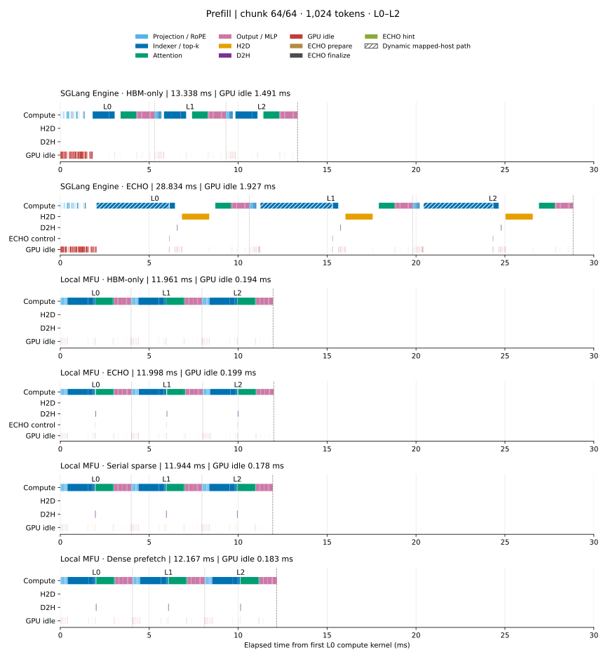
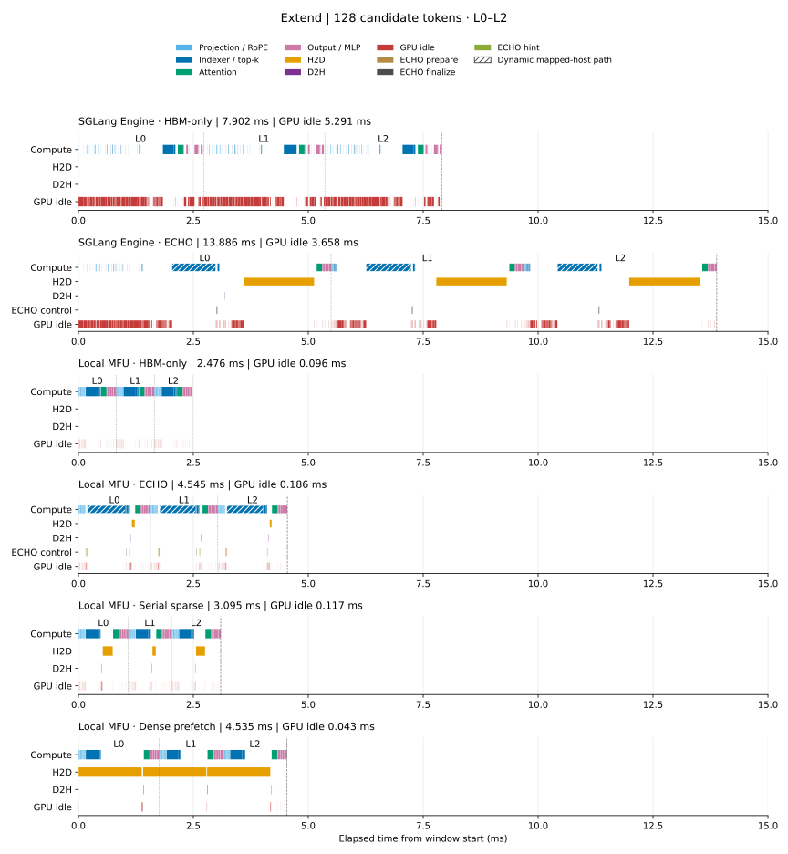
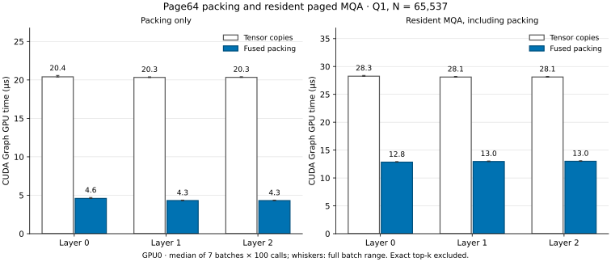
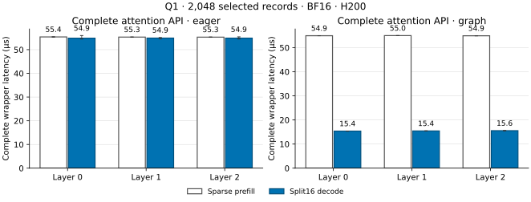

# DeepSeek V3.2 官方 SGLang 性能复现

本实验检查 ECHO 官方 SGLang 的性能，使用真实 DeepSeek V3.2 checkpoint 第 0–2 层、
原始 FP8 权重和 BF16 主 KV，包含 embedding、final norm 和末 token LM head。
当前重点是 H64K 正常 decode、本地 ECHO 对照及缓存控制开销。

**H64K + A1 请直接阅读[独立报告](report/h64k_a1/README.md)。**
官方与本地 ECHO 的 timeline、缓存控制、recall/H2D 和 indexer 分析已集中到该报告。

**官方跨实现数值验收仍为 `false`。** 本地内核与 cache 事务的独立验收已通过，
但两边的环境、容量和操作顺序仍有差异，以下结果不建立数值等价或策略加速比。
独立计时与侵入式 NSYS 窗口分别报告。

Engine 执行、分析和绘图入口位于本实验的 `src/`、`scripts/`；原始数据、日志和
trace 位于 `output/data/<run_id>/`、`output/log/<run_id>/`、`output/profile/<run_id>/`。
官方独立环境只读复用 `3rdparty/ECHO/reproduction/cxldsagr/`。
H64K+A128 与 HTTP 历史复用结果保留为下方补充，不用于解释 Q1 算子性能。

<details>
<summary>H64K+A128 Engine 结果与复现</summary>

## 直接 Engine

[执行入口](src/engine_run.py)调用 `sglang.Engine.generate`，先处理 H=65,536 的
history，再处理同一 history 加 A=128 的 candidate。两次 `cached_tokens` 为
0 和 65,536；prefill 覆盖 64 个 1,024-token chunk，extend 只计算新增 128 tokens。
两次调用各采样一个 token，没有后续 decode。

| 方案 | Prefill 样本数 | Prefill 中位数 ms | Extend 样本数 | Extend 中位数 ms |
| --- | ---: | ---: | ---: | ---: |
| SGLang Engine HBM-only | 3 | 1142.339 | 5 | 23.684 |
| SGLang Engine ECHO | 3 | 1830.076 | 5 | 30.164 |

两组使用 GPU7（H200 / SM90）、CPU72–79、NUMA1、8 个 OMP/MKL 线程，
TP=DP=1、page size=64。HBM-only 有 131,072 个 device 槽；ECHO 有 65,664 个
device 槽和 16,777,216 个 host 槽，不是等容量或等 HBM 字节预算对照。
五个正式 Engine 各先预热两次；统计前三次 prefill 和全部五次 extend。

计时覆盖 `generate` 调用到完整 Python 结果返回，包含调度、IPC、计算和采样；
构造、预热与输出检查在计时外。官方保留 radix 和自然驻留，本地 offload 对照使用
cold 状态。两组负载也不同于 HTTP 多用户轨迹，不能相减估计 HTTP 开销。
数据见[样本](report/sglang_engine/benchmark_samples.csv)、
[报告](report/sglang_engine/report.json)和[发布清单](report/sglang_engine/publication.json)。

### GPU timeline

六方案共用时间轴：prefill 为 0–30 ms，取最后一个 chunk；extend 为 0–15 ms，
取完整 128-token batch。窗口从 L0 首个计算 kernel 到 L2 最后计算 kernel，
本地 dense 若有更早的历史 H2D，也完整保留。NSYS 窗口包含 profiler 影响。





| SGLang Engine 方案 | Prefill 窗口 ms | Prefill GPU idle ms | Extend 窗口 ms | Extend GPU idle ms |
| --- | ---: | ---: | ---: | ---: |
| HBM-only | 13.338 | 1.491 | 7.902 | 5.291 |
| ECHO | 28.834 | 1.927 | 13.886 | 3.658 |

红色只表示 GPU idle，控制操作计入 busy。融合 indexer 的斜线表示潜在
mapped-host IO，橙色 recall 条表示完整 kernel；实际字节未知。
独立零 miss 诊断发现，A128 recall 仍扫描全部 16,777,216 个 host 槽位的标记，
耗时约 1.530 ms，主要受标记扫描影响，见[recall 诊断](report/recall_diagnosis.md)。

精确窗口和来源见[Prefill 数据](report/combined_prefill/windows.csv)、
[Prefill 来源](report/combined_prefill/provenance.json)、
[Extend 数据](report/combined_extend/windows.csv)及
[Extend 来源](report/combined_extend/provenance.json)。

### 来源与复现

| 阶段 | HBM-only run ID | ECHO run ID |
| --- | --- | --- |
| 独立检查 | `first3_engine_warm_hbm_check_20261006_01` | `first3_engine_warm_echo_check_20261006_01` |
| 正式计时 | `first3_engine_warm_hbm_bench_20261006_01` | `first3_engine_warm_echo_bench_20261006_01` |
| NSYS | `first3_engine_warm_hbm_profile_20261006_02` | `first3_engine_warm_echo_profile_20261006_01` |

SGLang 报告为 `first3_engine_warm_report_20261006_01`，合图为
`engine_mfu_prefill_20261006_04`、`engine_mfu_extend_20261006_03`。
本地阶段 profile 来自 `deepseek_dense_late_wait_profile_20261006_01`。
[合图入口](src/compare_timeline.py)复用本地 MFU 的分类工具，只重绘已发布数据。

```bash
PYTHONDONTWRITEBYTECODE=1 \
MPLCONFIGDIR=experiments/deepseek_v32_echo_official/output/runtime/cache/matplotlib \
.venv/bin/python -B -m experiments.deepseek_v32_echo_official.src.compare_timeline --phase prefill \
  --output-dir experiments/deepseek_v32_echo_official/output/data/engine_mfu_prefill_20261006_05

PYTHONDONTWRITEBYTECODE=1 \
MPLCONFIGDIR=experiments/deepseek_v32_echo_official/output/runtime/cache/matplotlib \
.venv/bin/python -B -m experiments.deepseek_v32_echo_official.src.compare_timeline --phase extend \
  --output-dir experiments/deepseek_v32_echo_official/output/data/engine_mfu_extend_20261006_04
```

从仓库根目录执行模型检查、计时和 profile，使用新的 run ID：

```bash
set -euo pipefail
export OMP_NUM_THREADS=8 MKL_NUM_THREADS=8
engine_repro_id=engine_repro_new
for engine_repro_case in resident_reference echo; do
  numactl --physcpubind=72-79 --membind=1 \
    bash experiments/deepseek_v32_echo_official/scripts/run_engine.sh \
    --run-id "${engine_repro_id}_${engine_repro_case}_check" \
    --case "$engine_repro_case" --mode check --gpu 7 --performance-only \
    --numerical-diagnostic 3rdparty/ECHO/reproduction/cxldsagr/output/acceptance/diagnostic_first3_triplet_20261006_01.json
  for engine_repro_mode in bench profile; do
    numactl --physcpubind=72-79 --membind=1 \
      bash experiments/deepseek_v32_echo_official/scripts/run_engine.sh \
      --run-id "${engine_repro_id}_${engine_repro_case}_${engine_repro_mode}" \
      --case "$engine_repro_case" --mode "$engine_repro_mode" --gpu 7 --performance-only \
      --check-run "experiments/deepseek_v32_echo_official/output/data/${engine_repro_id}_${engine_repro_case}_check" \
      --numerical-diagnostic 3rdparty/ECHO/reproduction/cxldsagr/output/acceptance/diagnostic_first3_triplet_20261006_01.json
  done
done
```

[NSYS 导出](scripts/export_nsys.py)、[窗口分析](src/engine_timeline.py)及
[报告生成](src/report_engine.py)均支持 `--help`。绘图使用项目 `.venv`，
模型执行使用 ECHO 独立环境。

</details>

## H64K 正常 decode

H=65,536、A=Q=1 的结果集中在独立的
[H64K + A1 报告](report/h64k_a1/README.md)。报告包含同输入 warm ECHO timeline、
官方 HBM-only 对照、GPU control 分解、recall/H2D 计数与 indexer 差异，
cold 四方案作为补充。两边共用绘图风格与 Indexer 统计范围，原始活动和测量身份
保持不变。

| 结果，L0–L2 GPU 窗口 | ms |
| --- | ---: |
| 官方 HBM-only | 1.014975 |
| 官方 ECHO | 1.555390 |
| 本地同输入 warm ECHO | 1.226051 |

<details>
<summary>Q1 独立算子优化结果</summary>

### Q1 瓶颈与优化结果



| 独立 CUDA Graph 计时边界 | 原实现 µs | 保留实现 µs |
| --- | ---: | ---: |
| K/scales 打包，真实 L0–L2 输入 | 20.328–20.405 | 4.308–4.587 |
| Resident MQA 完整适配，不含 exact top-k | 28.107–28.261 | 12.841–12.993 |
| Official scores 的完整 exact top-k，真实 L0–L2 | 50.976–51.680 | 49.280–49.680 |

打包与 exact top-k 的值、索引逐位验收通过。数据来自独立算子运行，见
[官方路径报告](report/q1_official_path/report.md)，展示 run ID 为
`q1_official_path_subset_report_20261011_01`；它不代表完整模型的配对收益。



Attention 使用 16 分片执行 sparse prefill，再合并 partial。完整 Graph API 从
54.92–54.99 µs 降至 15.37–15.55 µs；最大绝对差为 `4.88e-4`，通过原
`atol=4e-3, rtol=2e-2`。主 kernel 从 2 个 CTA 增至 32 个，见
[attention 报告](report/q1_optimization/report.md)。


同输入 L2 原始 fused core 的冷／热 map 诊断测得 NCU 时长为
55.008 / 10.880 µs：cold 实际预取 64 条、73,728 B，fully resident 不搬运。
原子与搬运同时消失，不能分离二者成本，也不能用 NCU 时长代替正式 API 计时。
见[冷态预取诊断](report/q1_prefetch_diagnosis/report.md)。

</details>

### Decode 来源与复现

独立官方 recall 观测为 `h64k_decode_echo_recall_observe_20261011_02`：L0–L2
各有 0 条 DRAM→HBM、0 条 staging→HBM，`recall_counter` 均为 0。
[观测入口](src/decode_recall_observer.py)在实际 graph 中保存 recall 输入和计数，
请求完成后读回；这是一轮带快照节点的独立观测，不报告正式延迟。
证据见[逐层计数](report/decode_recall_observation/layers.csv)、
[输入快照](report/decode_recall_observation/recall_observation.json)和
[来源](report/decode_recall_observation/provenance.json)。

| 阶段 | HBM-only run ID | ECHO run ID |
| --- | --- | --- |
| 独立检查 | `h64k_decode_hbm_check_20261008_03` | `h64k_decode_echo_check_20261008_01` |
| 正式计时 | `h64k_decode_hbm_bench_20261008_01` | `h64k_decode_echo_bench_20261008_01` |
| NSYS | `h64k_decode_hbm_profile_20261008_05` | `h64k_decode_echo_profile_20261008_02` |

官方报告为 `h64k_decode_report_20261008_01`，保存独立检查、计时和 profile 的来源。
[编排](scripts/run_decode.py)、[graph 归属](src/decode_graph_inspector.py)及
[窗口分析](src/decode_timeline.py)复用已有 Engine 生命周期、GraphInspector 和
CUPTI/NVTX 工具。官方源码只读，分析入口支持 `--help`；`--publish` 只发布到新目录。

<details>
<summary>复现独立 recall 观测</summary>

```bash
OMP_NUM_THREADS=8 MKL_NUM_THREADS=8 \
numactl --physcpubind=72-79 --membind=1 \
  bash experiments/deepseek_v32_echo_official/scripts/run_decode.sh \
  --run-id h64k_decode_echo_recall_observe_new --case echo --mode observe --gpu 7 \
  --performance-only \
  --numerical-diagnostic 3rdparty/ECHO/reproduction/cxldsagr/output/acceptance/diagnostic_first3_triplet_20261006_01.json

.venv/bin/python -B -m experiments.deepseek_v32_echo_official.src.report_decode_recall_observation \
  --run experiments/deepseek_v32_echo_official/output/data/h64k_decode_echo_recall_observe_new \
  --output experiments/deepseek_v32_echo_official/output/data/h64k_decode_echo_recall_report_new
```

</details>

<details>
<summary>复现检查、正式计时与 NSYS 分析</summary>

```bash
set -euo pipefail
export OMP_NUM_THREADS=8 MKL_NUM_THREADS=8
decode_repro_id=decode_repro_new
for decode_repro_case in resident_reference echo; do
  numactl --physcpubind=72-79 --membind=1 \
    bash experiments/deepseek_v32_echo_official/scripts/run_decode.sh \
    --run-id "${decode_repro_id}_${decode_repro_case}_check" \
    --case "$decode_repro_case" --mode check --gpu 7 --performance-only \
    --numerical-diagnostic 3rdparty/ECHO/reproduction/cxldsagr/output/acceptance/diagnostic_first3_triplet_20261006_01.json
  for decode_repro_mode in bench profile; do
    numactl --physcpubind=72-79 --membind=1 \
      bash experiments/deepseek_v32_echo_official/scripts/run_decode.sh \
      --run-id "${decode_repro_id}_${decode_repro_case}_${decode_repro_mode}" \
      --case "$decode_repro_case" --mode "$decode_repro_mode" --gpu 7 --repeats 3 --performance-only \
      --check-run "experiments/deepseek_v32_echo_official/output/data/${decode_repro_id}_${decode_repro_case}_check" \
      --numerical-diagnostic 3rdparty/ECHO/reproduction/cxldsagr/output/acceptance/diagnostic_first3_triplet_20261006_01.json
  done
  python3 -B -m experiments.deepseek_v32_echo_official.scripts.export_nsys \
    --input "experiments/deepseek_v32_echo_official/output/profile/${decode_repro_id}_${decode_repro_case}_profile/decode.nsys-rep"
done

PYTHONDONTWRITEBYTECODE=1 \
MPLCONFIGDIR=experiments/deepseek_v32_echo_official/output/runtime/cache/matplotlib \
.venv/bin/python -B -m experiments.deepseek_v32_echo_official.src.decode_timeline \
  --hbm-check "experiments/deepseek_v32_echo_official/output/data/${decode_repro_id}_resident_reference_check" \
  --hbm-bench "experiments/deepseek_v32_echo_official/output/data/${decode_repro_id}_resident_reference_bench" \
  --hbm-profile "experiments/deepseek_v32_echo_official/output/data/${decode_repro_id}_resident_reference_profile" \
  --hbm-sqlite "experiments/deepseek_v32_echo_official/output/profile/${decode_repro_id}_resident_reference_profile/decode.sqlite" \
  --echo-check "experiments/deepseek_v32_echo_official/output/data/${decode_repro_id}_echo_check" \
  --echo-bench "experiments/deepseek_v32_echo_official/output/data/${decode_repro_id}_echo_bench" \
  --echo-profile "experiments/deepseek_v32_echo_official/output/data/${decode_repro_id}_echo_profile" \
  --echo-sqlite "experiments/deepseek_v32_echo_official/output/profile/${decode_repro_id}_echo_profile/decode.sqlite" \
  --output "experiments/deepseek_v32_echo_official/output/data/${decode_repro_id}_report"
```

</details>

<details>
<summary>HTTP 与 H64K+A128 补充结果、环境及复现</summary>

## HTTP 固定历史结果

每组先在独立服务中预热 3 条请求，再启动新服务，顺序执行 16 个用户的两轮访问，
共 32 条正式请求。

| 方案 | 访问 | 请求数 | 完整 history 命中 | 平均延迟 ms | 中位延迟 ms | p95 ms |
| --- | --- | ---: | ---: | ---: | ---: | ---: |
| SGLang HBM-only | 首次 | 16 | 0/16 | 1238.838 | 1216.973 | 1311.721 |
| SGLang HBM-only | 复访 | 16 | 0/16 | 1222.878 | 1222.715 | 1229.755 |
| SGLang ECHO offload | 首次 | 16 | 0/16 | 1930.418 | 1906.806 | 2021.202 |
| SGLang ECHO offload | 复访 | 16 | 16/16 | 74.499 | 73.663 | 80.046 |

HBM-only 与 ECHO 的 32 条请求计时总和分别为 **39.387 s / 32.079 s**，
复访吞吐分别为 **0.818 / 13.423 请求/秒**，分母为各组 16 条复访请求的计时总和。
ECHO 的复访均命中完整的 65,536-token 历史，HBM-only 均重建历史；耗时差包含
历史复用的影响，不能归为 attention kernel 加速。p95 按排序位置 `(n-1)*0.95`
线性插值，只描述本轮轨迹。

| 报告 | run ID | 分组统计 | 逐请求数据 | 完整数据与来源 |
| --- | --- | --- | --- | --- |
| [HBM-only](report/sglang_fixed_history/hbm/report.md) | `first3_hbm_perfonly_20261006_01` | [CSV](report/sglang_fixed_history/hbm/summary.csv) | [CSV](report/sglang_fixed_history/hbm/requests.csv) | [JSON](report/sglang_fixed_history/hbm/report.json) |
| [ECHO offload](report/sglang_fixed_history/echo/report.md) | `first3_echo_perfonly_20261006_04` | [CSV](report/sglang_fixed_history/echo/summary.csv) | [CSV](report/sglang_fixed_history/echo/requests.csv) | [JSON](report/sglang_fixed_history/echo/report.json) |

## 与本地完整 CUDA Graph MFU 对比

下表汇总 H64K+A128 的独立结果，来源见 [deepseek_v32_mfu](../deepseek_v32_mfu/README.md)。
三种实现均执行真实 checkpoint 第 0–2 层，H=65,536、A=128、history chunk=1,024，
使用 FP8 权重和 BF16 主 KV。本地采用 `cold` 设置，extend 使用一次完整 CUDA Graph。
表中为中位延迟；HTTP 各访问分组有 16 条请求，Engine 和本地各有 3 次 prefill、
5 次 extend 样本。

| 实现 | 首次完整请求 ms | 复访完整请求 ms | 完整 Prefill ms | 完整 Extend ms |
| --- | ---: | ---: | ---: | ---: |
| 官方 SGLang HTTP HBM-only | 1216.973 | 1222.715 | — | — |
| 官方 SGLang HTTP ECHO offload | 1906.806 | 73.663 | — | — |
| 官方 SGLang Engine HBM-only | — | — | 1142.339 | 23.684 |
| 官方 SGLang Engine ECHO | — | — | 1830.076 | 30.164 |
| 本地完整图 `hbm` | — | — | 644.938 | 3.326 |
| 本地完整图 `echo` | — | — | 648.375 | 5.716 |
| 本地完整图 `serial_sparse` | — | — | 640.701 | 4.265 |
| 本地完整图 `dense_prefetch` | — | — | 645.800 | 5.706 |

本地 prefill 覆盖全部 64 个 chunk，extend 覆盖完整 128-token 追加。计时包含
计算、IO、启动、输入准备、事务、同步和提交，不采用 NSYS 裁剪后的三层窗口。
Prefill 使用 v4 计算图；extend 的 embedding、三层、cache/IO、final norm 与 LM head
在一次 graph replay 中执行。

HTTP 首次请求同时处理 history 和 candidate，Engine 与本地分阶段计时，不能将
两个阶段中位数之和当作实测首次请求中位数。Engine 包含调度、IPC 和采样，保留
prefill 后的自然 HBM 驻留；本地 offload 每次 cold extend 前清除历史主 KV 的 HBM 驻留。
以下条件也限制了跨框架比较。

| 对比条件 | 官方 SGLang HTTP | 本地 MFU（完整 extend 图） |
| --- | --- | --- |
| 计时范围 | HTTP 序列化至完整响应接收、JSON 解码，包含服务端执行和末 token 采样 | 进程内同步 wall time，包含 embedding、三层、final norm 和末 token LM head；加载、编译、graph setup、prefix 恢复在计时外 |
| 历史状态 | 16 用户两轮访问；ECHO 复访均命中完整历史，HBM-only 复访均重建历史 | 每次 extend 恢复同一 prefix；`hbm` 保留主 KV，三个 offload 方法清除历史主 KV 的 HBM 驻留，保留 DRAM 与 resident indexer，即 `cold` |
| 容量与生命周期 | ECHO 为 65,664 device / 16,777,216 host token 槽；HBM-only 为 131,072 device 槽；radix 保留 H+A | 每层 pool 和 host arena 均为 65,664 tokens；普通持久追加，下一样本前恢复 prefix，未运行多用户容量轨迹 |
| Indexer 与数值状态 | 保留 Hadamard；数值验收未通过 | RoPE 后直接量化，不执行 Hadamard；本轮 cold check 的 13 项标准比较、44 项完整图检查通过，未完成跨框架数值等价验收 |
| 运行环境 | GPU 7，H200 / SM90；CPU 72–79，NUMA 1；Torch 2.8.0+cu128 | GPU 3，H200 SXM / SM90；CPU 24–31；Torch 2.12.1+cu130、Triton 3.7.1 |
| 预热 | 独立服务预热 3 条请求，再启动空 cache 的正式服务；模型与算子首次使用开销仍计入请求 | 每种方法的 prefill/extend 各预热 1 次；prefill 使用 `deepseek-compute-islands-v4-bound-inputs`，extend 使用 `deepseek-full-extend-graph-v2-dense-late-wait` |

因此，HTTP ECHO 的 73.663 ms 复访与本地 `echo` 的 5.716 ms cold extend 只作为
各自条件下的耗时对照。HTTP HBM-only 的复访包含历史重建，与本地 `hbm` extend
工作量不同。两组不是等容量或等字节预算实验，也未完成跨框架数值等价验收，
不据此报告等价实现或 attention kernel 的加速倍数。

本地同轮的整段 MFU 如下，官方尚未测量相同口径的 MFU。

| 本地方法 | Prefill MFU | Extend MFU |
| --- | ---: | ---: |
| `hbm` | 44.90% | 20.30% |
| `echo` | 44.66% | 11.81% |
| `serial_sparse` | 45.19% | 15.83% |
| `dense_prefetch` | 44.84% | 11.83% |

整段 MFU 为 `100 × Σ精度(有效矩阵 FLOPs / 对应 dense 峰值) / 独立同步 wall-time`。
H200 的 FP8/BF16/FP32 dense 峰值分别为 1979/989.5/67 TFLOP/s，非矩阵操作、IO、
控制与空闲均留在分母中。Prefill 覆盖全部 64 个 chunk，extend 覆盖完整阶段，
该指标不表示 NCU 测得的 Tensor Core 活跃率。

计时来源为 `deepseek_dense_late_wait_bench_20261006_01`，见
[计时样本](../deepseek_v32_mfu/report/full_extend_graph/mfu/timing_samples.csv)、
[整段 MFU 表](../deepseek_v32_mfu/report/full_extend_graph/mfu/final_mfu.csv)及
[汇总](../deepseek_v32_mfu/report/full_extend_graph/mfu/summary.json)。
[来源记录](../deepseek_v32_mfu/report/full_extend_graph/mfu/provenance.json)和
[发布清单](../deepseek_v32_mfu/report/full_extend_graph/mfu/publication_manifest.json)
保留本轮验证与运行身份，逐算子结果见[本地报告](../deepseek_v32_mfu/README.md#当前版本-mfu)。

## HTTP 负载与容量

H=65,536、A=128、history prefill chunk=1,024，16 用户按相同顺序访问两轮，seed=42。
TP=DP=1，串行请求，page size=64，context length=131,072。每次 `/generate` 接收
完整 H+A token IDs，计算全部 candidate hidden，再从末 token logits 采样一个 token；
没有后续 decode forward。

| 方案 | device 可用 token 槽 | host token 槽 | allocator padding |
| --- | ---: | ---: | ---: |
| SGLang ECHO offload | 65,664，即 64K+128 | 16,777,216 | device 额外 1 槽 |
| SGLang HBM-only | 131,072 | 无 host KV pool | device 额外 64 槽 |

容量已由 allocator 日志和 scheduler 状态核验。ECHO 的 device pool 由 history 与
candidate 共同使用，NH 是共享逻辑 host token 配额，本轮未填满 NH。HBM-only
调度器从总池扣除 6 个 prompt 位置，65,664 槽无法接收完整请求，因此使用已跑通的
131,072 槽配置。**两组不是等容量或等 HBM 字节预算对照。**

官方 radix 保留完整 H+A：ECHO 将 candidate 写入 host，HBM-only 留在 HBM，
不采用本地 candidate discard 或 session LRU。Indexer 保留官方 Hadamard 和量化，
主 KV 为 BF16；这些语义与本地 C10 不同，结果不能直接拼入 C10 对照。

## HTTP 计时与数值状态

计时从 HTTP 序列化开始，覆盖服务端执行、完整响应接收和 JSON 解码；输出检查、
文件保存、模型加载及环境初始化在计时外，正式请求不返回完整 hidden/logprobs。
预热服务关闭后，正式服务从空 radix 和 allocator 开始。磁盘 JIT cache 可复用，
但新服务内模型与算子的首次使用开销仍计入请求。

三个独立数值检查保存了 96 份输出：resident 重跑的 16/32 条、ECHO 的 19/32 条
比较未通过预定门槛，全部 greedy token 一致。按用户要求继续测量性能，未调整门槛
或签发通过记录；两份报告均为 `numerical_acceptance=false`，差异尚未归因于单一根因。
检查原件在本地 `3rdparty/ECHO/reproduction/cxldsagr/output/acceptance/diagnostic_first3_triplet_20261006_01.json`。

请求完成、容量、报告签名与逐请求统计已核对。离散观测中的本进程显存最大值为
HBM-only 13,532 MiB、ECHO 20,068 MiB，包含初始化；这不是连续峰值、PyTorch
allocated/reserved 或 cache 字节预算验收。进程与释放检查见各自完整报告。

## 环境与来源

ECHO 固定提交为 `bc1b75c1000010d0ac6f032ebaac283255c050b1`，上游已跟踪源码保持
原样。独立环境为 SGLang 0.5.3.post3、Torch 2.8.0+cu128、ECHO DeepGEMM 2.1.1、
sgl-kernel 0.3.16.post2、FlashInfer 0.4.0、Transformers 4.57.1；FlashMLA 固定到
ECHO CI 使用的 `1408756a88e52a25196b759eaf8db89d2b51b5a1`。

两组使用相同模型字节、负载、官方计算源码、native 构建、精度与客户端计时边界，
均运行于 GPU 7（H200 / SM90），CPU 72–79、NUMA 1，OMP/MKL 线程数为 8。
具体身份保存在各报告 JSON，[发布清单](report/sglang_fixed_history/publication.json)
绑定完整文件 SHA256；选定报告按原字节复制，原签名保持不变。

原始数据位于本地
`3rdparty/ECHO/reproduction/cxldsagr/output/data/first3_echo_perfonly_20261006_04/` 和
`3rdparty/ECHO/reproduction/cxldsagr/output/data/first3_hbm_perfonly_20261006_01/`，
日志在同一复现目录的 `output/log/<run_id>/`，不随项目 Git 分发。

## HTTP 复现

从仓库根目录进入已有独立复现目录，使用新的 run ID；这里不经过项目模型或
serving 入口。

```bash
cd 3rdparty/ECHO/reproduction/cxldsagr
export OMP_NUM_THREADS=8 MKL_NUM_THREADS=8

numactl --physcpubind=72-79 --membind=1 \
  bash scripts/run.sh --run-id sglang_echo_new \
  --case echo --mode bench --gpu 7 --performance-only \
  --numerical-diagnostic output/acceptance/diagnostic_first3_triplet_20261006_01.json

numactl --physcpubind=72-79 --membind=1 \
  bash scripts/run.sh --run-id sglang_hbm_new \
  --case resident_reference --mode bench --gpu 7 --performance-only \
  --numerical-diagnostic output/acceptance/diagnostic_first3_triplet_20261006_01.json

source env/activate.sh
python -B -m src.report --run output/data/sglang_echo_new
python -B -m src.report --run output/data/sglang_hbm_new
```

</details>
