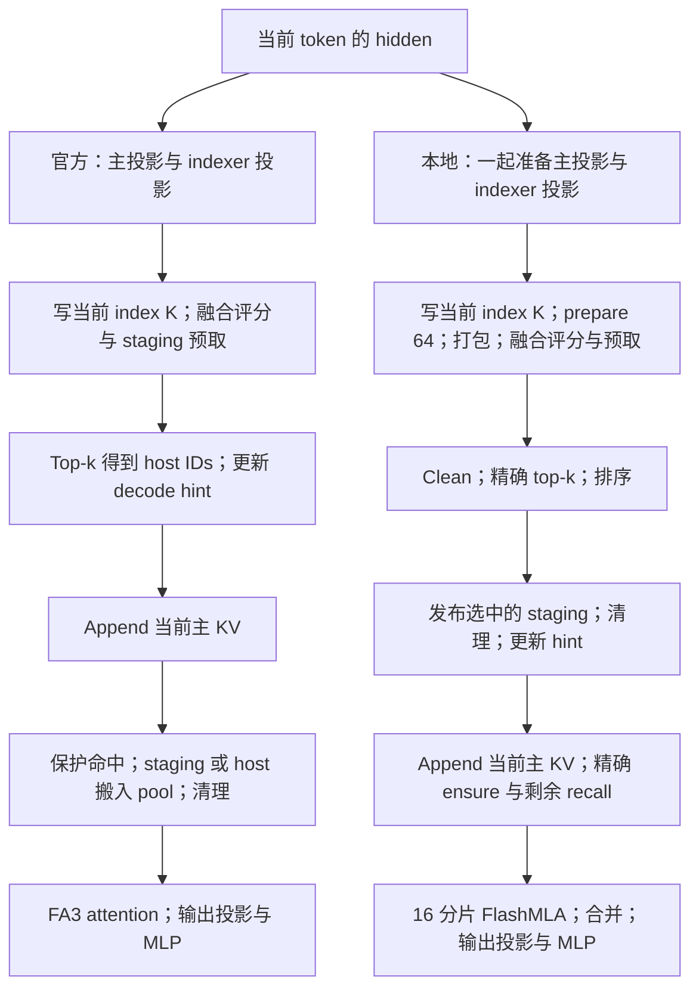
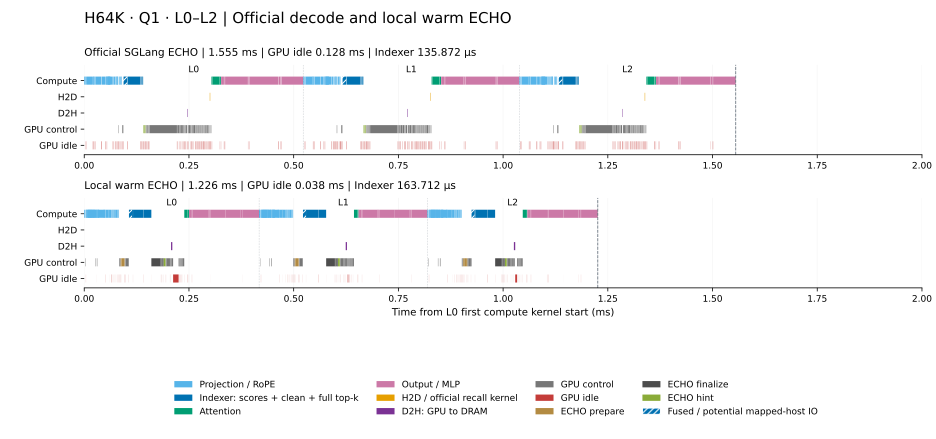
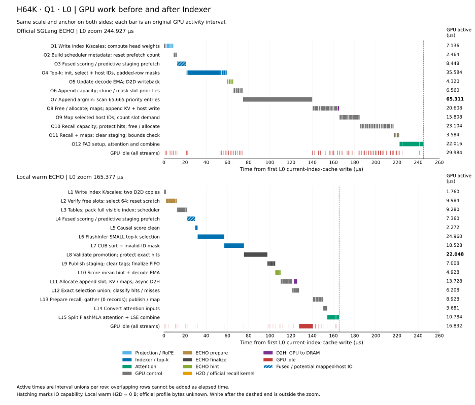
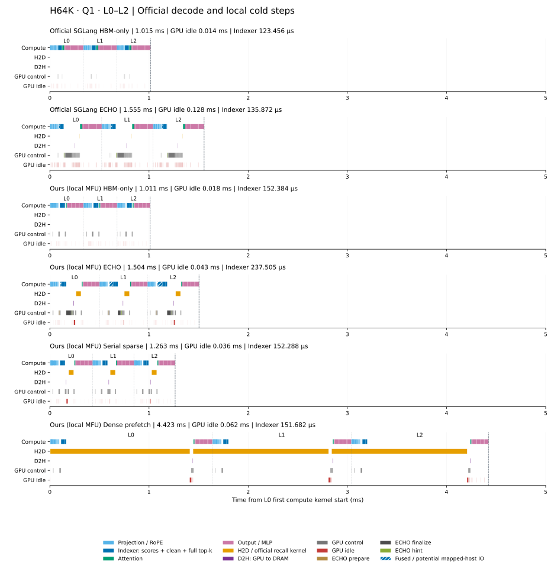

# H64K + A1：官方与本地 ECHO 对照

本报告关注 65,536-token history 后的一次单 token 执行：H=65,536、A=Q=1、
有效 sequence=65,537。使用真实 DeepSeek V3.2 checkpoint 第 0–2 层、FP8 权重
和 BF16 主 KV；这不是完整模型的延迟报告。

同输入对照中，官方 ECHO 的 L0–L2 GPU 窗口为 **1.555390 ms**，本地 warm ECHO
为 **1.226051 ms**。窗口差为 329.339 µs，其中约 81% 来自 control 独占区间和
GPU idle。评分核心的差距较小，本地完整 top-k 则更长。

**官方跨实现数值验收仍为 `false`。** 两边的环境、容量和缓存操作顺序存在差异；
这些结果用于分析执行开销，不建立数值等价或缓存策略加速比。本报告整理已有测量，
没有新增 GPU 运行。

## 对照条件

两边的 65,536 个 history tokens 已逐项核对，单 token 输入都是 **57841**。
官方一次 `Engine.generate(max_new_tokens=2)` 完成 prefill，采样 57841，随后
执行一次正常 `DECODE`，再采样 39556。本地显式输入 57841，不包含采样。

| 条件 | 官方 ECHO | 本地 warm ECHO |
| --- | --- | --- |
| History 状态 | 保留正常 radix 与 prefill 后的自然驻留 | 保留 prefill 主 KV 驻留，每个样本前恢复相同 prefix |
| GPU / CPU | GPU7，H200 / SM90；CPU72–79，NUMA1 | GPU0，H200 / SM90；CPU0–7 |
| 主 KV 容量，token 槽 | device 65,664；host 16,777,216 | P=NH=65,600 |
| 执行 | 官方默认 CUDA Graph；TP=DP=1，page size=64 | 本地完整 extend CUDA Graph；普通持久 append |
| Indexer | 64 heads、D=128、top-k=2,048；保留 Hadamard | 相同形状；RoPE 后直接 FP8 量化，没有 Hadamard |
| 正式计时 | 3 个新 Engine，各预热 2 次正常请求 | 独立进程，预热 1 次，5 个单步样本 |

官方请求结束后的驻留快照不能证明旧 profile 在 decode 开始时的完整状态。
相同 token 输入也不证明两边的 hidden、scores 或 top-k 数值一致。
官方环境为 SGLang 0.5.3.post3、Torch 2.8.0+cu128、ECHO DeepGEMM 2.1.1，
ECHO 提交为 `bc1b75c1000010d0ac6f032ebaac283255c050b1`；完整依赖和构建身份
见[官方来源](../sglang_decode/report.json)与[本地来源](../../../deepseek_v32_mfu/report/h64k_a1_warm/summary.json)。

## 逐层 decode 流程

以下按这份报告对应的官方固定版本和本地测量版本解释。H=65,536，当前 token
位于逻辑位置 65,536；两边的精确选择都覆盖 65,537 个可见位置，选取 2,048 条。
当前 token 是否入选取决于分数，不能把 top-k 理解成固定选择 2,048 个历史 token。

### 执行前保存了什么

| 数据 | 用途与位置 |
| --- | --- |
| Indexer K 与 scale | 每个 token 的小型索引 record，保留在 HBM；用来给全部可见 token 评分 |
| 主 MLA KV | 每条为 512 维 latent 加 64 维 RoPE K，共 576 个 BF16，即 1,152 B；host 保存历史，有限 HBM pool 保存驻留副本 |
| 映射与分配状态 | 逻辑 token / host ID / HBM slot 之间的映射，以及 free 状态、priority/FIFO；决定 record 在哪里、哪些槽可以分配 |
| Decode staging | HBM 中最多 64 条的临时预取缓冲，保存预测的主 KV；还不是正式 pool 槽 |
| Decode hint | 执行前保留的预测阈值；初始化与更新范围由各实现决定，本轮 top-k 后更新 |

Indexer 扫描的是较小的索引 K。主 attention 读取精确选中的 2,048 条主 KV。
因此，history 主 KV 不在 HBM 时仍能先评分。精确召回补齐选中的缺失记录；
预测阶段还可能搬入最终未被 top-k 选中的记录。
融合预取通过 GPU kernel 读取 mapped pinned host memory，实际 H2D 不一定在
NSYS 中表现为独立的 `cudaMemcpy` 条。

临时映射有三种状态：真实 HBM slot 表示已经驻留；missing 表示未驻留；
`pool_rows + staging_slot` 表示记录在临时 staging。最后一种编码不能直接交给
主 attention，必须转成正式 pool 槽或在清理时撤销。



两列表示各自的执行依赖，并不表示两个实现同时运行。下面展开每列的具体操作。

### 官方 ECHO

**1. 准备主 attention 的 Q 和当前主 KV。** 当前 hidden 经过归一化与投影，
得到 Q 和压缩 latent KV，应用 RoPE，并将 Q 的非 RoPE 部分吸收到 latent 空间。
此时当前主 KV 已算出，但还没有写进正式 cache。

**2. 生成并写入当前 indexer K。** Indexer 使用主 Q 分支的低秩表示生成自己的
Q，并从 hidden 生成 K；执行归一化、RoPE、Hadamard 和 FP8 量化，计算各 head
的权重。当前 index K/scales 先写入 HBM 索引 cache，再开始评分。
所以评分包含当前 token，尽管它的主 KV 尚未 append。

**3. 融合评分与预测预取。** Paged MQA 通过 64-token 页表读取索引 K，计算
全部可见位置的 FP32 scores。数学 warp 产出分数后，预取 warp 根据旧 decode
hint 检查 `score > threshold`，只处理历史位置、且主 KV 映射仍为 missing 的记录。
当前 token 被排除在提前搬运之外。

符合条件的历史记录竞争最多 64 个 staging 槽，将主 KV 从 host 搬到 staging，
并写入临时映射。预测发生在完整 top-k 出来之前，选中的集合不保证等于最终 top-k。
原子预约计数也可能超过 64，实际成功暂存的条数受 64 条上限约束。
评分与搬运在同一个 kernel 内形成流水，不代表整段时间都是 IO。

**4. 做 top-k 并更新阈值。** `topk_transform_decode_kernel` 选择 2,048 个位置，
直接将逻辑位置转换成 host IDs，供后续主 KV 查询使用。官方输出没有本地相同的
完整排序与稳定 ID 并列规则。该路径取最后输出项的分数，以 decay=0.5 更新
decode hint；不能未经数值核验就把它与本地排序后的精确第 k 分数视为相同。
本轮评分已经使用旧阈值，新阈值供后续 decode 使用。

**5. Append 当前主 KV。** 主 attention backend 先调用 `set_mla_kv_buffer`。
它计算需要的槽数和可用槽数，调用腾槽、allocator free/alloc、priority 更新和
双向映射更新，再将当前主 KV 写入 HBM 与 host。正式 decode graph 中 host 写回
也捕获在图内。这里执行了后文分析的 append `argmin`。

这个 append 分支没有传入完整 top-k 作为保护集合；精确命中的保护发生在下一步。
因此要在 append 之后重新查映射，不能沿用评分前的驻留状态判断。

**6. 补齐精确选择。** 对 top-k 的 host IDs 查询当前映射，分成三类：
真实 pool 命中无需复制；staging 命中需要 staging→pool 的 D2D；未预取的 miss
需要 host→pool 的 H2D。后两类都需要正式 pool 槽，所以用于分配的 `recall_size`
包含 staging 命中，不能直接将它当成 DRAM 搬运条数。

官方先保护已有真实命中，再按所需数量腾槽、分配并更新 priority。
`recall_update_with_prefetch` 在同一 kernel 中处理复制、双向映射与选中物理页表
更新。后续 attention 等该 kernel 完成后才消费结果。未选中的 staging tag
随后清除，选中记录已经变成真实 pool 映射，保留在 pool 中。

**7. Attention 和层输出。** 这轮官方 ECHO 的 offload decode 实际调用 FA3
`flash_attn_with_kvcache`，读取精确选择的物理页表；使用 RoPE Q/K、latent KV
以及吸收后的非 RoPE Q 计算 attention。它不是这轮本地使用的 FlashMLA 路径。
得到 latent 输出后，通过 value 展开、O projection、残差与归一化、dense MLP，
产生下一层输入。L0、L1、L2 重复以上流程。

### 我们的 ECHO

**1. 在模型事务内准备投影。** 外层先为所有层执行 `begin_step(1)`，本次使用
普通持久 append。每层的 projection 一起返回主 Q、当前 576 维主 KV、index Q/K、
scale 和 head weights；索引分支执行 RoPE 后直接 FP8 量化，没有官方 Hadamard。
当前 index K/scales 同样先写入派生索引 cache，声明 65,537 个位置可用于评分。

**2. Prepare 预取资源并打包索引。** 官方 Q1 融合 kernel 将预取上限固定为 64 条，
本地沿用这个上限。本轮 P=65,600、H=65,536，单 session 独占，P−H=64 满足
至少准备 64 个合法空槽的条件。GPU 仍检查 free 状态与反向映射，并重置计数、
journal 和预取 scratch；容量足够本身不证明 history 已驻留。

本地 index K/scales 使用自己的布局，需要转换成官方 kernel 接收的 page64
packed 布局，同时准备 block table、逻辑位置到 host ID 的表和临时 staging。
这轮每次调用、每次 graph replay 都打包当前完整可见索引，不保留 packed history
副本。官方 index cache 本来就是对应页式布局，不需要这层全历史适配。

**3. 调用同源融合评分核心。** 使用同一官方 Q1 fused kernel，严格阈值来自
`offset[1]`，同样只提前搬运缺失的历史主 KV，最多成功暂存 64 条，并写临时 tag。
本地随后独立执行 causal clean，将不可见及尾部 padding 的分数置为 `-inf`。
官方这轮不启动独立 clean，而由 top-k 按有效 length 消费 scores。

**4. 保留精确 top-k 的排序契约。** FlashInfer SMALL 选择 2,048 条，再用 CUB
按分数降序、相同有序浮点 key 的 ID 升序排序，并将非有限项的 ID 置为 −1。
结果包含分数与逻辑 token IDs，还没有全部转换成正式主 KV 的物理槽。
这一步保留我们的选择契约，也是完整 top-k 比官方更长的原因之一。

**5. 先发布选中的 staging，再 finalize。** 用精确逻辑 IDs 匹配暂存记录，
只将最终选中的历史预测复制到正式 pool，分配时保护已有精确命中；未选中的
预测不长期驻留。Promotion 复制并发布双向映射；随后清除剩余临时 tag，finalize
根据已发布的 journal 更新 free/FIFO/clock、累计计数并结束 prefetch lease。
已有命中在 promotion 期间的保护不改变其持久 FIFO 时间戳。图持有的 staging
storage 仍保留，这一步也不是全模型事务提交。

这一步发生在当前主 KV append 之前，是与官方的重要顺序差异。
本地 cache 明确要求先 finalize，才能 append 或进行普通精确 recall。

**6. 更新 hint，再 append 当前主 KV。** 本地维护两种 hint：`offset[0]` 为
既有的有限 scores 均值提示，`offset[1]` 为 Q1 decode 阈值。后者按
`0.5 × old + 0.5 × sorted_kth_score` 更新，当前融合预取仍使用更新前的值。
之后将当前主 KV 写入正式 pool、发布映射，并写回 host；本轮每层 D2H 为 1,152 B。
本地优先使用合法空槽，满足单 session 和容量条件时走有界空槽分配路径。

**7. 精确 ensure，召回剩余 miss。** `_ensure_from_topk` 将精确逻辑选择映射到
pool 槽，查询并保护已有记录；只对仍缺失的记录分配槽和执行 host→pool 召回。
选择中的当前 token 此时已经 append，可以直接映射到它的新槽。本轮容量足够
一次消费完整 top-k，不需要拆分 query 或裁剪选择。

我们的 `prefetched_records` 统计实际 host→staging 的记录，包括后来未被 top-k
选中的预测；`recalled_records` 统计之后剩余的 host→pool 召回。因此本轮 BF16
record 布局下，每层实际 H2D 为：

`(成功暂存条数 + 剩余召回条数) × 1,152 B`。

Staging→pool 是 D2D，不重复计为 H2D；promotion 条数也不能替代成功暂存条数。
官方的 `recall_size` 和 `recall_counter` 包含 staging→pool 与 host→pool 两类记录。
融合预测的 `query_recall_counter` 则是 staging 预约计数，可能超过 64；这三个量
都不能直接当作实际 DRAM 搬运条数。

**8. 分片 MLA、层输出与统一提交。** 本地将 2,048 个选中槽分成 16 份，每份
128 条，用官方 sparse prefill FlashMLA 计算 partial 输出与 LSE，再按 LSE 权重
合并为完整 attention 输出；仍消费全部精确选择，没有减少 top-k。
随后执行 value 展开、O projection、残差与归一化、dense MLP。
三层、final norm 和末 token LM head 完成并同步成功后，外层统一提交各层 cache，
有效长度从 H 推进到 H+1。测量下一样本前恢复 prefix；这次不是 candidate discard
入口，也不代表一次真实请求执行完后会自动删掉当前 token。

### Warm 状态下为什么仍有控制时间

这轮本地 warm 在当前主 KV append 后，精确选择全部命中，成功暂存和剩余召回
都是 0。它仍执行了 prepare、融合评分、promotion/finalize、hint、append 和
精确选择映射等节点。
原因是测量恢复了实际 KV 与映射，却使 host 端的“完整驻留已认证”快捷证明失效；
不能仅凭 H≤P 或保存过 warm prefix 跳过检查。GPU 映射说明没有 miss，所以
实际 H2D 为 0；控制节点仍负责维护事务、slot 和映射状态。

官方独立 observer 的 residual recall 也为 0，固定 graph 中的槽数计算、保护、
allocator、priority 和 tag 清理节点仍会执行或提前返回。旧 profile 的 append
argmin 扫描仍实际发生，不能根据结束后的驻留快照推断它本应被跳过。

两个实现均将本轮 top-k 映射后的主 KV 交给 attention，但评分前处理、top-k 契约、
promotion/append 顺序、分配器和 attention 后端均有差异。“都执行融合 ECHO”
并不意味着完整 decode 是同一条实现。

实际调用顺序见官方[indexer](../../../../3rdparty/ECHO/sglang/python/sglang/srt/layers/attention/nsa/nsa_indexer.py)、
[decode backend](../../../../3rdparty/ECHO/sglang/python/sglang/srt/layers/attention/nsa_backend.py)、
[host pool](../../../../3rdparty/ECHO/sglang/python/sglang/srt/mem_cache/memory_pool_host.py)，
以及本地[逐层 attention](../../../../models/deepseek_v32/attention.py)、
[cache](../../../../cache/sparse_token_cache.py)、
[staging 适配](../../../../operators/deepseek_v32/indexer/official_prefetch.py)和
[分片 MLA](../../../../operators/deepseek_v32/attention/device_only/decode.py)。
源码身份与本轮 profile 的对应关系补充在[分析来源](provenance.json)中；后续实现变更
不能自动沿用本报告的测量数字。

## 同输入 ECHO timeline



两组共用 0–2 ms 时间轴。窗口从 L0 首个计算 kernel 到 L2 最后计算 kernel，
取自独立 NSYS 采集，包含 profiler 影响。两侧共用绘图函数、颜色、字体、泳道高度、
刻度和图例；层边界保留实际时间。蓝色 Indexer 的统一范围见下方统计说明。
红色表示没有 kernel、memcpy 或 memset 的 GPU idle；GPU control 表示实际 GPU
控制活动。

两侧融合评分/预取 kernel 都画斜线，表示其中包含 mapped-host 预取路径。
本地 warm 虽然实际预取为 0 条、0 B，仍保留这个标记；斜线不代表实际 H2D
时间或字节数。它只覆盖融合评分 kernel，后续 clean 和 top-k 仍画实色。

| L0–L2 指标 | 官方 ECHO | 本地 warm ECHO |
| --- | ---: | ---: |
| 窗口 ms | 1.555390 | 1.226051 |
| Compute 并集 µs | 1000.703 | 932.190 |
| Compute 和明确 IO 之外的 control µs | 423.839 | 246.657 |
| 明确 IO 独占区间 µs | 3.200 | 9.216 |
| GPU idle µs | 127.648 | 37.988 |

后四行互不重叠，合计为窗口。本地原始 control 泳道并集为 260.737 µs，
与 Compute 有重叠，不能直接相加。窗口差中，control 独占区间少 177.182 µs，
idle 少 89.660 µs，两项合计占 **81.02%**。这说明差距主要落在缓存控制和
节点间空闲，不能直接归为缓存策略收益。

独立正式计时中，本地完整同步 step 的中位数为 **2.397285 ms**，包含输入、
事务、同步和提交；加载、编译、图准备与 prefix 恢复在计时外。官方完整请求
中位数为 **1842.270 ms**，包含全部 prefill、一次 decode、两次采样、调度和 IPC。
这两项覆盖的工作不同，都不能替代上表的三层窗口。

### Indexer 前后的放大图



以 **L0** 为例，从当前 index K/scales 的首次写入开始，截到 attention combine
结束。两边共用 0–260 µs 刻度；这里的零点是 index cache 写入，比上面全图的
L0 起点稍晚。官方放大窗口为 244.927 µs，本地为 165.377 µs。

每行标出一项 GPU 工作，条形保留原始 kernel 或 memcpy 的实际区间与空隙。
右列是该行的 GPU 活跃区间并集，单位为 µs；不同工作有重叠，不能直接相加当作
经过时间。底行红色是所有 stream 都无活动的区间；虚线后的白色已在窗口之外。

- **评分之前：** 官方写索引并计算 head weights，再准备 scheduler metadata；
  本地还要检查并准备 64 个空槽、重置 scratch，将完整可见索引打包成 page64 布局。
- **Top-k 之后：** 官方先更新 hint，再 append 当前主 KV；O7 扫描 65,665 个
  priority 项（65,664 个可用槽加一个 sentinel），耗时 65.311 µs。随后 O8–O11
  分配、更新映射、统计 recall 槽需求、保护命中并清理 staging。本地先执行 L8
  的 2,048 条精确选择校验与命中保护，耗时 22.048 µs，再 finalize、更新 hint、
  append 和精确 ensure。本轮 staging 为空，L8 仍检查已有精确命中，L9 的发布
  节点执行但没有记录需要复制。
- **搬运与空隙：** 本地 L11 的 1,152 B 异步 D2H 与 L12 的映射检查重叠；
  L12 后有 13.088 µs 的无 GPU 活动区间。L13 的 gather 节点实际搬运 0 条。
  两边融合 kernel 都保留斜线，本地实际 H2D 为 0 B，官方旧 profile 的字节数未知。

图中的深蓝段仍使用同一 Indexer 范围：官方 O3–O4，本地 L4–L7，包含评分、
实际 causal clean 和完整 top-k 输出流程。逐项区间与节点 ID 见
[GPU 工作明细](indexer_detail/segments.csv)，来源见
[放大图 provenance](indexer_detail/provenance.json)。这张图重绘已有 NSYS 数据，
没有新增 GPU 测量。

### 每一步对应的代码

下表沿用放大图的 O1–O12、L1–L15 编号。左侧链接是调用入口，右侧链接是
实际 kernel 或生成该 GPU 活动的语句。一行可能包含多个 kernel，不能把整个
Python 函数的时间当作该行 GPU 时间。当前引用的源码已与本轮构建或冻结测量
副本核对，文件哈希和节点对应关系见[代码位置与来源](code_map.json)。

**图的起点之前：投影与 head weights。** 官方主投影和 indexer 调用在
[forward_absorb_prepare](../../../../3rdparty/ECHO/sglang/python/sglang/srt/models/deepseek_v2.py#L1518)，
其中 [self.indexer 调用](../../../../3rdparty/ECHO/sglang/python/sglang/srt/models/deepseek_v2.py#L1646)
进入 [Indexer.forward_cuda](../../../../3rdparty/ECHO/sglang/python/sglang/srt/layers/attention/nsa/nsa_indexer.py#L666)。
本地在 [attention_projection](../../../../models/deepseek_v32/attention.py#L321) 中调用
[project_positions](../../../../models/deepseek_v32/projections.py#L182)，
[243–244 行](../../../../models/deepseek_v32/projections.py#L243) 已计算 head weights：
`F.linear(x.float(), index_head_weight)`，再乘 head 数缩放、Q scale 和 head dim 缩放。
本地 L0 的这部分在层起点后 71.616–83.040 µs，早于放大图零点 84.640 µs；
官方在写索引之后才计算，因此显示在 O1。两边都执行了这项工作。

**官方 ECHO**

| 图段 | 工作 | 调用入口 | GPU 实现或发射语句 |
| --- | --- | --- | --- |
| O1 | 写 index K/scales；head weights | [写 index cache](../../../../3rdparty/ECHO/sglang/python/sglang/srt/layers/attention/nsa/nsa_indexer.py#L716)；[_get_logits_head_gate](../../../../3rdparty/ECHO/sglang/python/sglang/srt/layers/attention/nsa/nsa_indexer.py#L239) | [_set_k_and_s_triton_kernel](../../../../3rdparty/ECHO/sglang/python/sglang/srt/layers/attention/nsa/index_buf_accessor.py#L315)；gate 内的 FP32 转换、linear 和缩放生成 cuBLAS / Triton 活动 |
| O2 | Scheduler metadata；清预取计数 | [metadata 调用](../../../../3rdparty/ECHO/sglang/python/sglang/srt/layers/attention/nsa/nsa_indexer.py#L351)；[counter.fill_(0)](../../../../3rdparty/ECHO/sglang/python/sglang/srt/layers/attention/nsa/nsa_indexer.py#L386) | [smxx_paged_mqa_logits_metadata](../../../../3rdparty/ECHO/DeepGEMM/deep_gemm/include/deep_gemm/impls/sm90_fp8_paged_mqa_logits.cuh#L21)；PyTorch fill kernel |
| O3 | 融合评分与预测 staging 预取 | [fp8_paged_mqa_logits_fused_v2 调用](../../../../3rdparty/ECHO/sglang/python/sglang/srt/layers/attention/nsa/nsa_indexer.py#L391) | [JIT launcher](../../../../3rdparty/ECHO/DeepGEMM/csrc/jit_kernels/impls/smxx_fp8_paged_mqa_logits.hpp#L333) → [fused_v2 kernel](../../../../3rdparty/ECHO/DeepGEMM/deep_gemm/include/deep_gemm/impls/sm90_fp8_paged_mqa_logits.cuh#L413)；同一 kernel 内评分、检查阈值并搬运缺失历史 |
| O4 | 完整 top-k、host ID 转换、padding masks | [topk_transform](../../../../3rdparty/ECHO/sglang/python/sglang/srt/layers/attention/nsa_backend.py#L136) | [kth-logit 输出初始化](../../../../3rdparty/ECHO/sglang/sgl-kernel/python/sgl_kernel/top_k.py#L85)；[topk_transform_decode_kernel](../../../../3rdparty/ECHO/sglang/sgl-kernel/csrc/elementwise/topk.cu#L251)；[arange / mask 后处理](../../../../3rdparty/ECHO/sglang/python/sglang/srt/layers/attention/nsa_backend.py#L174) |
| O5 | 更新 decode EMA | [decode_topk_logits 更新](../../../../3rdparty/ECHO/sglang/python/sglang/srt/layers/attention/nsa/nsa_indexer.py#L413) | 两次乘法、一次加法，slice assignment 将 EMA D2D 写回 |
| O6 | Append 容量计算；clone / mask priority | [set_mla_kv_buffer](../../../../3rdparty/ECHO/sglang/python/sglang/srt/mem_cache/memory_pool_host.py#L1097) 的 [容量计算](../../../../3rdparty/ECHO/sglang/python/sglang/srt/mem_cache/memory_pool_host.py#L1126) | [free_device_pool_cuda_graph](../../../../3rdparty/ECHO/sglang/python/sglang/srt/mem_cache/memory_pool_host.py#L1071) 内 clone、mask；生成 Torch CUDA 运算和 D2D copy |
| O7 | Append 扫描最小 priority | [get_free_loc](../../../../3rdparty/ECHO/sglang/python/sglang/srt/mem_cache/recall_ops.py#L674) → [fast_argmin_bounded](../../../../3rdparty/ECHO/sglang/python/sglang/srt/mem_cache/recall_ops.py#L696) | [argmin_bounded_kernel](../../../../3rdparty/ECHO/sglang/sgl-kernel/csrc/elementwise/topk.cu#L876)，读取 GPU free_size 并扫描 65,665 个 priority 项 |
| O8 | Free / allocate；priority、映射；append HBM 与 host KV | [free 调用](../../../../3rdparty/ECHO/sglang/python/sglang/srt/mem_cache/memory_pool_host.py#L1086)；[append 发布](../../../../3rdparty/ECHO/sglang/python/sglang/srt/mem_cache/memory_pool_host.py#L1139)；[host 写回](../../../../3rdparty/ECHO/sglang/python/sglang/srt/mem_cache/memory_pool_host.py#L1181) | [_free_update_kernel](../../../../3rdparty/ECHO/sglang/python/sglang/srt/mem_cache/recall_ops.py#L84)；[allocator free](../../../../3rdparty/ECHO/sglang/python/sglang/srt/mem_cache/allocator.py#L784) / [alloc](../../../../3rdparty/ECHO/sglang/python/sglang/srt/mem_cache/allocator.py#L745)；[_set_update_kernel](../../../../3rdparty/ECHO/sglang/python/sglang/srt/mem_cache/recall_ops.py#L134)；[HBM KV 写入](../../../../3rdparty/ECHO/sglang/python/sglang/srt/mem_cache/recall_ops.py#L216)；[mapped-host 写入](../../../../3rdparty/ECHO/sglang/python/sglang/srt/mem_cache/memory_pool.py#L1149) |
| O9 | 查询 host→device；分类并统计槽需求 | [映射查询与 need_device / sum](../../../../3rdparty/ECHO/sglang/python/sglang/srt/layers/attention/nsa_backend.py#L780) | PyTorch index、compare、where、reduce、cast；missing 与 staging 都计入普通 pool 槽需求 |
| O10 | Recall 容量；保护命中；free / allocate；priority | [recall_miss_tokens_decode_cuda_graph_with_prefetch](../../../../3rdparty/ECHO/sglang/python/sglang/srt/mem_cache/memory_pool_host.py#L1379) | [容量与保护调用](../../../../3rdparty/ECHO/sglang/python/sglang/srt/mem_cache/memory_pool_host.py#L1394) → [_protect_kernel](../../../../3rdparty/ECHO/sglang/python/sglang/srt/mem_cache/recall_ops.py#L45)；复用 O7/O8 的腾槽与分配，随后 [更新 priority](../../../../3rdparty/ECHO/sglang/python/sglang/srt/mem_cache/memory_pool_host.py#L1408) |
| O11 | 清 recall 计数；recall / maps；清 staging；边界检查 | [recall_update_with_prefetch](../../../../3rdparty/ECHO/sglang/python/sglang/srt/mem_cache/recall_ops.py#L479)；[清 staging 调用](../../../../3rdparty/ECHO/sglang/python/sglang/srt/mem_cache/memory_pool_host.py#L1425)；[边界检查调用](../../../../3rdparty/ECHO/sglang/python/sglang/srt/layers/attention/nsa_backend.py#L852) | [_recall_update_with_prefetch_kernel](../../../../3rdparty/ECHO/sglang/python/sglang/srt/mem_cache/recall_ops.py#L385)；[_clear_decode_prefetch_mappings_kernel](../../../../3rdparty/ECHO/sglang/python/sglang/srt/mem_cache/recall_ops.py#L525)；[check_device_pool_kernel](../../../../3rdparty/ECHO/sglang/python/sglang/srt/layers/attention/nsa_backend.py#L1127) |
| O12 | FA3 setup、attention、combine | [_forward_fa3](../../../../3rdparty/ECHO/sglang/python/sglang/srt/layers/attention/nsa_backend.py#L938) → [flash_attn_with_kvcache](../../../../3rdparty/ECHO/sglang/sgl-kernel/python/sgl_kernel/flash_attn.py#L39) | 实际构建依赖中的 [prepare scheduler](../../../../3rdparty/ECHO/reproduction/cxldsagr/deps/repo-flash-attention/hopper/flash_prepare_scheduler.cu#L15)、[FlashAttnFwdSm90](../../../../3rdparty/ECHO/reproduction/cxldsagr/deps/repo-flash-attention/hopper/flash_fwd_kernel_sm90.h#L29)、[FlashAttnFwdCombine](../../../../3rdparty/ECHO/reproduction/cxldsagr/deps/repo-flash-attention/hopper/flash_fwd_combine_kernel.h#L26) |

**本地 ECHO**

| 图段 | 工作 | 调用入口 | GPU 实现或发射语句 |
| --- | --- | --- | --- |
| L1 | 写当前 index K/scales | [index_cache_write](../../../../models/deepseek_v32/attention.py#L323) | 两个 slice assignment，生成两次 D2D copy |
| L2 | 检查 free 状态；选 64 个槽；重置 scratch | [prepare_prefetch](../../../../cache/sparse_token_cache.py#L741) → [有界 free 分派](../../../../cache/sparse_token_cache.py#L774) → [prepare_prefetch_free](../../../../operators/deepseek_v32/indexer/cache_ops.py#L462) | [prepare_masks](../../../../operators/deepseek_v32/indexer/csrc/echo_sparse_append_free.cuh#L11)、[select_slots](../../../../operators/deepseek_v32/indexer/csrc/echo_sparse_append_free.cuh#L26)、[reset_publish](../../../../operators/deepseek_v32/indexer/csrc/echo_sparse_prepare_free.cuh#L9)；选择上限为 64，journal 与槽表仍整体重置，scratch 重新生成 mask 并重置 metadata |
| L3 | Bounds、page64 打包、映射表、scheduler | [starts / ends 构造](../../../../operators/deepseek_v32/indexer/echo.py#L358)；[logits_from_keys](../../../../operators/deepseek_v32/indexer/official_prefetch.py#L326) → [_prepare_keys](../../../../operators/deepseek_v32/indexer/official_prefetch.py#L196)；[metadata](../../../../operators/deepseek_v32/indexer/official_decode.py#L143) | [prepare_keys_kernel](../../../../operators/deepseek_v32/indexer/csrc/official_prefetch.cu#L220) 打包完整可见索引；[metadata bridge](../../../../operators/deepseek_v32/indexer/csrc/official_decode.cu#L60) 发射同源 scheduler |
| L4 | 融合评分与预测 staging 预取 | [_logits_prepared](../../../../operators/deepseek_v32/indexer/official_prefetch.py#L295) → [official_decode.logits](../../../../operators/deepseek_v32/indexer/official_decode.py#L155) | [fused_v2 实例化与发射](../../../../operators/deepseek_v32/indexer/csrc/official_decode.cu#L106)，引用 O3 的同源 kernel；本轮预取 0 条 |
| L5 | Causal score clean | [clean 发射调用](../../../../operators/deepseek_v32/indexer/csrc/official_decode.cu#L120) | [clean bridge](../../../../operators/deepseek_v32/indexer/csrc/official_decode_clean.cu#L8)，将不可见与 padding scores 清为 −∞ |
| L6 | FlashInfer SMALL 精确 top-k | [exact_topk](../../../../operators/deepseek_v32/indexer/selection.py#L62) → [Q1 分派](../../../../operators/deepseek_v32/indexer/selection.py#L106) | [_official_topk_int32](../../../../operators/deepseek_v32/indexer/selection.py#L14) 的 radix_topk 调用，生成 FlashInfer FilteredTopKUnifiedKernel |
| L7 | CUB 排序与无效 ID mask | [sort_mask_ 调用](../../../../operators/deepseek_v32/indexer/selection.py#L109) → [native wrapper](../../../../operators/deepseek_v32/indexer/q1_topk_cub.py#L65) | [cub_sort_mask_kernel](../../../../operators/deepseek_v32/indexer/csrc/q1_topk_sort.cu#L15)；保证分数降序、同分 ID 顺序并处理无效项 |
| L8 | 校验 promotion；保护精确命中 | [精确选择发布入口](../../../../models/deepseek_v32/attention.py#L376) → [_promote](../../../../operators/deepseek_v32/indexer/official_prefetch.py#L229) | [validate_promotion_kernel](../../../../operators/deepseek_v32/indexer/csrc/official_prefetch.cu#L44)；检查 2,048 条选择与映射，暂时保护 pool 命中，本轮 staging 为空 |
| L9 | 发布 staging；清 tag；finalize FIFO、clock、计数 | [finalize_prefetch](../../../../cache/sparse_token_cache.py#L852)；[pool finalize](../../../../cache/sparse_token_pool.py#L681) | [copy_publish_kernel](../../../../operators/deepseek_v32/indexer/csrc/official_prefetch.cu#L144)、[clear_kernel](../../../../operators/deepseek_v32/indexer/csrc/official_prefetch.cu#L167)、[finalize_kernel / advance_clock_kernel](../../../../operators/deepseek_v32/indexer/csrc/echo_indexer.cu#L129)；本轮无 staging record 需要复制 |
| L10 | Score mean hint；decode EMA | [两种 hint 更新](../../../../models/deepseek_v32/attention.py#L385) → [update_prefetch_hint](../../../../operators/deepseek_v32/indexer/prefetch_hint.py#L38) / [update_decode_hint](../../../../operators/deepseek_v32/indexer/decode_hint.py#L24) | [mean_kernel](../../../../operators/deepseek_v32/indexer/csrc/q1_hint_exact.cu#L19)；[update_decode_ema](../../../../operators/deepseek_v32/indexer/decode_hint.py#L16) |
| L11 | 分配当前 KV 槽；append / maps；异步 D2H | [append](../../../../cache/sparse_token_cache.py#L290) 中 [sparse_append_free 分派](../../../../cache/sparse_token_cache.py#L367)；[write_host](../../../../cache/sparse_token_pool.py#L468) | [空槽分配发射](../../../../operators/deepseek_v32/indexer/csrc/echo_sparse_append_free.cuh#L90)；[planned_append_kernel](../../../../operators/deepseek_v32/indexer/csrc/echo_resident.cuh#L180)；write_host 内 copy_ 在独立 stream 执行 1,152 B D2H |
| L12 | 精确并集；hits / misses 分类 | [_ensure_from_topk](../../../../cache/sparse_token_cache.py#L571) → [_ensure_sparse_from_topk](../../../../cache/sparse_token_cache.py#L616) → [sparse_selection_classify](../../../../operators/deepseek_v32/indexer/cache_ops.py#L303) | [sparse_union_clear](../../../../operators/deepseek_v32/indexer/csrc/echo_sparse_recall.cuh#L8)、[sparse_union_kernel](../../../../operators/deepseek_v32/indexer/csrc/echo_sparse_recall.cuh#L22)、[sparse_classify_kernel](../../../../operators/deepseek_v32/indexer/csrc/echo_sparse_recall.cuh#L47) |
| L13 | Recall 槽准备；gather；发布；映射物理 IDs | [complete 调用](../../../../cache/sparse_token_cache.py#L672)；[map 调用](../../../../cache/sparse_token_cache.py#L728) → [recall bridge](../../../../operators/deepseek_v32/indexer/csrc/echo_recall_dispatch.cpp#L86) | [count / compact 空槽](../../../../operators/deepseek_v32/indexer/csrc/echo_sparse_free.cuh#L29)；[gather_records](../../../../operators/common/csrc/kv_transfer.cu#L14)；[sparse_publish_kernel](../../../../operators/deepseek_v32/indexer/csrc/echo_sparse_recall.cuh#L356)；[sparse_map_kernel](../../../../operators/deepseek_v32/indexer/csrc/echo_sparse_recall.cuh#L415)；本轮 gather 的 valid_count=0 |
| L14 | 复制 16 份 Q，准备分片 attention | [sparse_mla_decode](../../../../operators/deepseek_v32/attention/device_only/mla.py#L118) → [split_kv](../../../../operators/deepseek_v32/attention/device_only/decode.py#L90) | [q.repeat(DECODE_SPLITS, 1, 1)](../../../../operators/deepseek_v32/attention/device_only/decode.py#L93)，生成 BF16 copy kernel |
| L15 | 16 分片 FlashMLA；LSE combine | [flash_mla_sparse_fwd 与 combine 发射](../../../../operators/deepseek_v32/attention/device_only/decode.py#L94) | 该 API 发射 sparse prefill FlashMLA；[combine kernel](../../../../operators/deepseek_v32/attention/device_only/decode.py#L70) 按 LSE 合并 partial 输出 |

**Attention 之后与全模型事务。** 官方回到
[forward_absorb_core](../../../../3rdparty/ECHO/sglang/python/sglang/srt/models/deepseek_v2.py#L1665)
执行 value 展开和输出投影，再由
[DecoderLayer.forward](../../../../3rdparty/ECHO/sglang/python/sglang/srt/models/deepseek_v2.py#L2495)
执行残差、归一化和 MLP。本地对应
[CheckpointAttention.output](../../../../models/deepseek_v32/projections.py#L291)，
以及 [block.forward 的 post norm / MLP](../../../../models/deepseek_v32/layers.py#L307)。
外层 [model.forward](../../../../models/deepseek_v32/model.py#L749) 为各层 begin_step，
调用 [完整 graph replay](../../../../models/deepseek_v32/model.py#L763)，
成功后 [同步并统一 commit](../../../../models/deepseek_v32/model.py#L766)。
这些外层步骤与放大图的 GPU kernel 窗口分别计量。

红色 idle 区间没有对应的 GPU kernel；本地 L12→L13 之间可定位到
[wait_host](../../../../cache/sparse_token_cache.py#L649) 附近的依赖边界，
仅凭无活动区间仍不能把 13.088 µs 全部归因于这一行 Python 调用。

## 官方多出的 GPU control 在做什么

官方内部的 HBM-only 对照也执行同样的正常 decode。它使用 131,072 个 device
槽，容量与 ECHO 不同。

| 官方方案 | L0–L2 窗口 ms | Control 独占区间 µs | GPU idle µs | 完整 decode graph GPU 节点数 |
| --- | ---: | ---: | ---: | ---: |
| HBM-only | 1.014975 | 11.808 | 14.274 | 141 |
| ECHO | 1.555390 | 423.839 | 127.648 | 297 |

ECHO 多出的 540.415 µs 中，control 和 idle 增量合计 525.405 µs，约占 **97.22%**。
这是 decode 窗口的分析，不解释完整请求中 prefill 的全部差距。

下表保留原始 trace 的控制分类，用于定位具体节点；它与上表的功能分类及互斥
区间分解不同。

| 官方 ECHO 控制活动，原始分类 | L0–L2 累计 µs |
| --- | ---: |
| 槽位/FIFO、映射与缓存准备 `cache_control` | 346.015 |
| 当前 KV、indexer cache 写入及相关操作 `cache_write` | 27.392 |
| 精确 recall 元数据准备 `cache_recall` | 26.400 |
| Indexer / top-k 元数据 | 10.848 |
| 合计 | 410.655 |

这些 GPU 活动主要执行两套流程：当前 token append 前计算需要腾出的槽数，
按 priority/FIFO 选槽，释放、分配并更新双向映射；精确 top-k 后查询选中 token
的映射、统计 miss、保护已有命中，再准备 recall、发布映射并清理 staging。
固定 CUDA Graph 中，即使没有记录需要召回，相关准备与维护节点仍可能执行。

最大单项是 append 分支的 `argmin_bounded_kernel<196608>`。它使用单个 CTA、
1,024 个线程扫描 65,665 个 priority 项（65,664 个可用槽加一个 sentinel），
为当前 token 选择可腾出的槽。
三层耗时为 65.311 / 64.960 / 64.032 µs，合计 **194.303 µs**。GPU idle 是
节点间无活动区间的累计，现有证据没有确认它由 CPU 同步造成。

**O7 对应本地 L11 的 append 槽位选择。** 官方的 `argmin` 实际是按 priority
选取 `free_size` 个最小项，不是只返回一个最小值；它用于腾出当前 KV 所需的槽。
其单 CTA 执行 256-bin radix histogram、前缀和及逐级筛选，使用 shared-memory
atomic 和多次同步。至少前两遍扫描完整输入；候选桶超过 shared-memory 容量时，
后续阶段还要再扫描全池。因此这段时间不能按一次 256 KiB 读取的带宽解释。
这些是源码中的工作，尚未用 NCU 分离原子竞争、同步与读取各自的成本。

本地普通 append 在单 session 独占、追加后长度不超过 P 时选择
[sparse_append_free](../../../../cache/sparse_token_cache.py#L367)：
[prepare_masks](../../../../operators/deepseek_v32/indexer/csrc/echo_sparse_append_free.cuh#L11)
用多 CTA 检查全池 priority 并生成空槽位图，
[select_slots](../../../../operators/deepseek_v32/indexer/csrc/echo_sparse_append_free.cuh#L26)
选择并校验足够的实际空槽。本轮 L11 两个 kernel 分别为 1.632 / 5.824 µs，
合计 **7.456 µs**；之后 KV 写入与映射发布为 3.232 µs，异步 D2H 为 3.040 µs。
容量条件允许直接找空槽，但不代替 GPU free / owner 校验，也不证明 history 已驻留。
多 session 或容量条件不满足时保留普通 FIFO 分配。这与官方通用淘汰选择的工作不同，
不能用 65.311 / 7.456 报告同一算法的加速比。L2 复用相同空槽选择 kernel，
用于预取准备；它不是 O7 所在的当前-token append 阶段。

原始活动记录的 control lane 还包含 3.136 µs 的 recall kernel，合计 413.791 µs。
图中按功能将 recall 画在橙色 H2D 行，区间分解仍计入 control-only；它与上表的
410.655 µs 分类范围不同。细节见
[kernel 明细](../decode_gap/kernel_details.csv)和[区间分解](../decode_gap/report.json)。

## Recall 大小与 H2D 小片段

| 观测 | 每层 residual recall | 每层实际 H2D | 每层 D2H |
| --- | --- | --- | --- |
| 官方旧 NSYS profile | 未记录计数 | 字节未知 | 字节未知 |
| 官方独立 recall observer | DRAM→HBM 0 条；staging→HBM 0 条 | residual recall 0 B；融合预测流量未统计 | 未统计 |
| 本地 warm，5 个正式样本及独立 profile | 0 条；prefetch 也为 0 条 | 全部 H2D 0 B | 当前-token append 1,152 B |

**官方橙色 H2D 小条展示的是 recall kernel 的完整时长。** 三层合计 3.136 µs，
该 kernel 可以维护映射、执行复制，也可以不搬记录；旧 trace 没有实际字节证据。
融合 indexer 上的斜线同样只表示潜在 mapped-host IO。

另一次官方独立 observer 在实际 graph 中保存 recall 输入和计数，请求结束后读回。
L0–L2 的 `recall_counter` 均为 0，实际 residual recall 的 DRAM→HBM 与
staging→HBM 都为 0 条、0 B。它不统计融合 indexer 内的预测搬运，也不能把计数
回填到旧 NSYS profile。逐层证据见[recall 计数](../decode_recall_observation/layers.csv)。

本地使用 `official-q1-exact-selected-staging-v2`：最多暂存 64 条预测，只将精确
top-k 选中的历史预测发布到 pool，保护已有命中、清除未选中 tag；所有实际暂存
H2D 都计费，随后完整召回剩余选择。发布预测仍先于当前-token append，尚未完全
复刻官方顺序。本轮 warm 状态没有预取或召回流量，不能据此评估 cold 策略收益。

## Indexer 时间为什么不同

图中深蓝色 `Indexer / top-k` 统一统计**评分、因果清理和完整 top-k 输出流程**。
两侧都包含实际执行的初始化、选择、转换、排序与 mask，按三层窗口内所有 stream
的 GPU 区间并集计算；图中标题和下表使用同一统计函数。

主投影与 indexer Q/K 投影、归一化、RoPE、量化、head weights，以及官方的 Hadamard，统一放在
浅蓝色 `Projection / RoPE`。Scheduler、索引 cache 写入/打包、staging 准备、
pool 管理及 hint 更新归 control。融合评分 kernel 保留完整时长，内部预取不另行
拆出，也不扣除潜在 IO。

| 操作，L0–L2 累计 | 官方 µs | 本地 warm µs |
| --- | ---: | ---: |
| 融合评分主 kernel | 25.664 | 21.792 |
| 独立 causal clean | 无 | 6.880 |
| 完整 top-k，含初始化与后处理 | 110.208 | 135.040 |
| 图中深蓝区间并集 | **135.872** | **163.712** |

两边评分主 kernel 同源、模板参数相同，每层约 7–9 µs。本地另有 causal clean。
官方用一个主要 top-k kernel 选择并转换 host IDs，另有输出分数初始化、补齐
query 行的 arange/mask 与 masked-fill，这些均计入完整 top-k。本地先用 FlashInfer
SMALL 精确选择，再用 CUB 保证分数降序、同分 ID 顺序并屏蔽无效项。额外排序每层约
18.5 µs，因此本地完整 top-k 更长。不同 GPU、环境、输入数值和 profiler 影响
未隔离，评分的几微秒差异尚不能归于单一原因。

表格按 GPU 区间并集统计，逐层数值见[indexer 明细](indexer_breakdown.csv)，
提取边界和输入哈希见[分析来源](provenance.json)。原始活动、节点归属、时间戳、
窗口和 idle 均未改动，重分类的逐项理由保存在 `aligned_panels.json` 中。

<details>
<summary>补充：清空历史主 KV 驻留的本地 cold 四方案</summary>



这张图复用相同的颜色、字体、泳道高度、图例与 Indexer 口径，六组共用 0–5 ms
时间轴，完整保留 dense prefetch 的较长窗口。

| 方法 | 官方正常 decode L0–L2 ms | 本地 cold L0–L2 ms | 本地完整 step 中位数 ms |
| --- | ---: | ---: | ---: |
| HBM-only | 1.014975 | 1.011458 | 1.848991 |
| ECHO | 1.555390 | 1.503972 | 2.676780 |
| Serial sparse | — | 1.263427 | 2.430380 |
| Dense prefetch | — | 4.422828 | 5.527328 |

本地三个 offload 方法清空 history 主 KV 的 HBM 驻留，保留 DRAM 与 resident
indexer；官方保留自然驻留。两边输入 token、容量和环境也不同。
本地 cold ECHO 的 15 个层样本均暂存 64 条，residual recall 为 L0 1,983、
L1 2,030–2,042、L2 1,986–2,010 条；每层 H2D 为 2,358,144–2,426,112 B。
它与 warm 的 recall 差主要来自驻留条件，不能用不同输入和批次估计策略收益。

来源为 `deepseek_h64k_a1_exact_selected_cold_20261011_02`，合图为
`combined_decode_fused_display_20261012_01`；见[合图来源](../combined_decode_aligned/provenance.json)
与[输入、计数核验](../../../deepseek_v32_mfu/report/h64k_a1_warm/input_recall_audit/identity_recall.json)。

</details>

## 数据来源与复现

| 材料 | run ID / 来源 |
| --- | --- |
| 官方 HBM 检查 / 正式计时 / NSYS | `h64k_decode_hbm_check_20261008_03` / `h64k_decode_hbm_bench_20261008_01` / `h64k_decode_hbm_profile_20261008_05` |
| 官方 ECHO 检查 / 正式计时 / NSYS | `h64k_decode_echo_check_20261008_01` / `h64k_decode_echo_bench_20261008_01` / `h64k_decode_echo_profile_20261008_02` |
| 本地 warm ECHO 检查 / 正式计时 / NSYS | `deepseek_h64k_a1_official_input_warm_20261011_01_echo_check` / `deepseek_h64k_a1_official_input_warm_20261011_01_echo_bench` / `deepseek_h64k_a1_official_input_warm_20261011_01_echo_profile` |
| 同输入 timeline 展示 | `warm_decode_fused_display_20261012_01` |
| L0 Indexer 前后放大图 | `indexer_detail_20261012_01` |
| Cold 四方案 timeline 展示 | `combined_decode_fused_display_20261012_01` |
| 官方独立 recall 观测 | `h64k_decode_echo_recall_observe_20261011_02` |

[同输入对照来源](../warm_decode_aligned/provenance.json)、
[发布清单](../warm_decode_aligned/publication_manifest.json)、
[官方发布清单](../sglang_decode/publication.json)与
[本地发布清单](../../../deepseek_v32_mfu/report/h64k_a1_warm/publication_manifest.json)
保留原测量身份。正式 forward 和完整 decode graph 的节点归属已核验；NSYS
collector 的进程级警告仍保留，不宣称 setup、warmup 或整个 trace 都已核验。

完整原始 panel 与统一分类的 panel 分别位于
`experiments/deepseek_v32_echo_official/output/data/warm_decode_fused_display_20261012_01/panels.json`
和同目录的 `aligned_panels.json`。
官方执行入口为[decode_run.py](../../src/decode_run.py)，本地入口为
[q1_warm_alignment.sh](../../../deepseek_v32_mfu/scripts/q1_warm_alignment.sh)，
两侧合图入口为[compare_warm_decode_timeline.py](../../src/compare_warm_decode_timeline.py)。
检查、计时、profile、recall 观测及重绘命令见[实验入口](../../README.md#decode-来源与复现)。

<details>
<summary>重绘同输入 warm timeline，无需 GPU</summary>

从仓库根目录执行，使用新的 output 目录：

```bash
PYTHONDONTWRITEBYTECODE=1 \
MPLCONFIGDIR=experiments/deepseek_v32_echo_official/output/runtime/cache/matplotlib \
CUDA_VISIBLE_DEVICES= .venv/bin/python -B \
  -m experiments.deepseek_v32_echo_official.src.compare_warm_decode_timeline \
  --official-report experiments/deepseek_v32_echo_official/report/sglang_decode \
  --warm-report experiments/deepseek_v32_mfu/report/h64k_a1_warm \
  --output-dir experiments/deepseek_v32_echo_official/output/data/warm_decode_comparison_new
```

</details>

<details>
<summary>重绘 L0 Indexer 放大图，无需 GPU</summary>

```bash
PYTHONDONTWRITEBYTECODE=1 \
MPLCONFIGDIR=experiments/deepseek_v32_echo_official/output/runtime/cache/matplotlib \
CUDA_VISIBLE_DEVICES= .venv/bin/python -B \
  -m experiments.deepseek_v32_echo_official.src.indexer_detail_timeline \
  --comparison-report experiments/deepseek_v32_echo_official/report/warm_decode_aligned \
  --output-dir experiments/deepseek_v32_echo_official/output/data/indexer_detail_new
```

</details>
