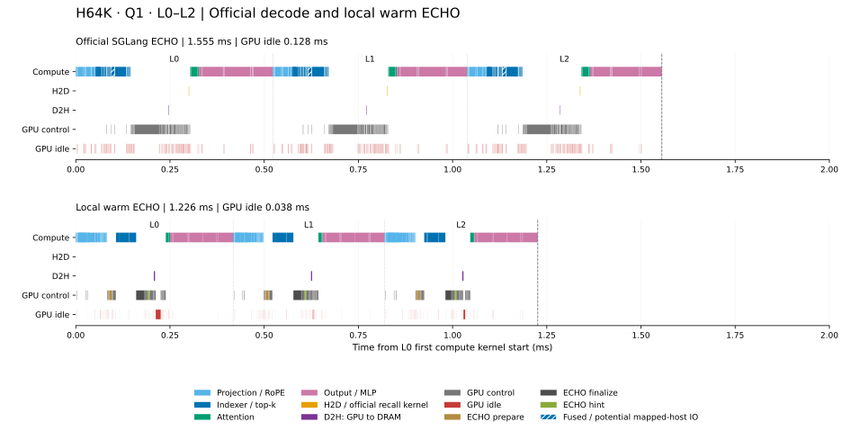

# 官方正常 decode 与本地 warm ECHO

展示运行 `warm_decode_comparison_20261012_01` 复用已发布的 L0–L2 profile，未新增 GPU 测量。两侧 history token 数组一致，H=65,536、Q=1，输入 token 均为 57841；本地显式输入该 token，不包含采样。本地保留 prefill 后的主 KV 驻留，官方保留正常 radix 与自然驻留。

| 来源 | 窗口 ms | Compute 并集 ms | Control-only ms | 明确 IO 独占 ms | Idle ms | 原 Control lane 并集 ms |
| --- | ---: | ---: | ---: | ---: | ---: | ---: |
| Official SGLang | 1.555390 | 1.010751 | 0.413791 | 0.003200 | 0.127648 | 0.413791 |
| Local warm | 1.226051 | 0.932190 | 0.246657 | 0.009216 | 0.037988 | 0.260737 |

Control-only 是 Compute 和明确 IO 之外仍有 GPU 活动的区间。前三项工作区间与 idle 构成互不重叠的窗口分解；原 control lane 并集单列，不能与它们重复相加。融合 indexer 保留整段 Compute 时间，图中的橙色 recall 条按功能展示，不能当作纯 H2D。

本地窗口少 329.339 µs，其中 control 独占区间少 167.134 µs、idle 少 89.660 µs，两者合计占窗口差的 77.97%。

官方旧 trace 的 recall 活动共 3.136 µs，实际 mapped-host 字节未知。另一次独立 observer 运行观测到三层 residual recall 都为 0 条、0 B，这一计数不回填旧 trace，也不覆盖融合 indexer 的预测流量。本地 warm 的正式计时与 profile 计数均为每层 H2D 0 B、D2H 1,152 B。

两侧使用不同的框架环境、GPU、pool 容量及缓存操作顺序。官方跨实现数值验收仍为 `false`；输入一致不证明模型数值或缓存策略等价。这些侵入式窗口不等于完整请求延迟，不用于计算配对加速比，也不能把窗口差直接归为缓存策略收益。完整原始 panel、输入报告副本和源码快照保留在本次 `output/data/` 运行目录；[来源](provenance.json)、[窗口](windows.csv)和[发布清单](publication_manifest.json)绑定展示素材。
