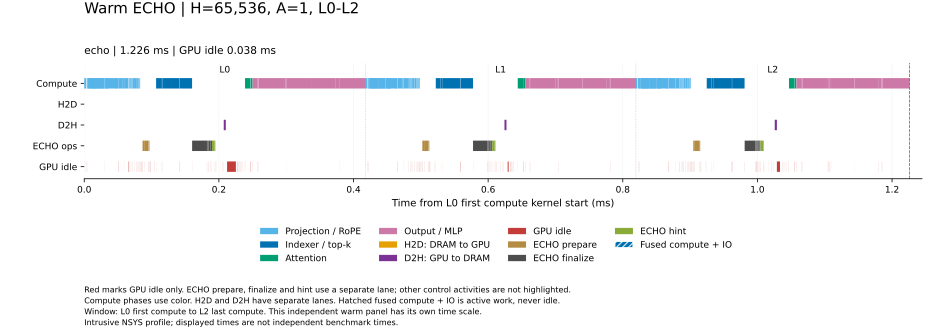

# 本地 ECHO warm Q1 对照

运行 `deepseek_h64k_a1_official_input_warm_20261011_01` 保留 prefill 后的主 KV 驻留，每次单步前恢复相同 prefix。输入追加 token 为 57841。真实 L0–L2，H=65,536、A=1、P=NH=65,600，GPU0 / CPU0–7；四个独立进程分别完成 HBM 检查、ECHO 检查、ECHO 正式计时和最小节点 profile。

完整同步单步 wall 中位数为 2.397285 ms；独立 NSYS 的 L0–L2 窗口为 1.226051 ms，GPU idle 为 37.988 µs。Wall 包含输入、事务、同步和提交，加载、编译、图准备和 prefix 恢复在计时外。Profile 窗口不等于完整单步延迟。

[逐层流量与召回计数](cache_samples.csv)、[全部 wall 样本](timing_samples.csv)、[来源及身份](provenance.json)、[完整审计](summary.json)分别保留正式计时和 profile 的证据。已重读保存输出、receipt、源码、native、原始 GPU 活动和 graph 归属。warm 对齐驻留条件，不自动证明与官方 SGLang 的缓存策略、输入或环境完全一致；本报告不计算 MFU，也不以不同批次推断加速。

展示更新 `deepseek_h64k_a1_warm_timeline_display_20261012_02` 复用四方案 timeline 的泳道、计算阶段配色、L0–L2 分界和图例；仅从已验收的 profile 数据重绘，未新增 GPU 测量。原始时间戳、计数和延迟保持不变；来源见 [展示记录](display_provenance.json)。
